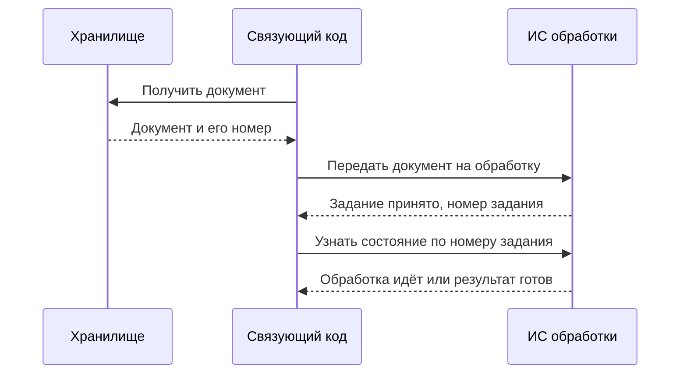

# Содержание

- [[#Интерфейсы двух информационных систем]]
- [[#Путь одного документа]]
- [[#Номер документа и номер задания]]
- [[#Практика на учебном проекте]]
- [[#Главное]]

# Обмен документами между информационными системами

**18.11.2026 · Введение в профессиональную деятельность**

## Интерфейсы двух информационных систем

Одна информационная система (ИС) хранит документы, другая выполняет задания по их обработке. Чтобы обработать документ из хранилища, программа обращается к обеим системам через их **API** (Application Programming Interface). API определяет, какие операции доступны программе, какие данные нужно передать при обращении и что можно получить в ответ.

| Участник | Роль в примере |
|---|---|
| ИС хранения | По запросу выдаёт документ и его номер. |
| Связующий код | Получает документ, отправляет его на обработку и запрашивает состояние задания. |
| ИС обработки | Принимает документ, присваивает заданию номер и сообщает, продолжается ли обработка или результат уже готов. |

## Путь одного документа

Диаграмма читается сверху вниз. Сплошная стрелка обозначает запрос связующего кода, пунктирная — ответ системы.

В этом примере обработка **асинхронная**. Система сначала подтверждает приём документа и выдаёт номер задания. Результат появляется позже. Если первый запрос состояния вернул «обработка идёт», связующий код может позже повторить запрос с тем же номером. Ответ «результат готов» означает, что работа завершена.

## Номер документа и номер задания

**Номер документа** относится к объекту в хранилище. **Номер задания** относится к работе, которую выполняет вторая система. Связующему коду нужно сохранить соответствие между этими номерами, чтобы затем соотнести ответ обработчика с исходным документом.

Например, хранилище выдало документ, а система обработки подтвердила приём и прислала номер задания. Чтобы узнать, можно ли получить результат для этого документа, связующий код передаёт обработчику выданный им номер задания. Повторная отправка самого документа для проверки состояния не требуется.

## Практика на учебном проекте

| Что попробовать | Какой навык отработать |
|---|---|
| Установить Linux и запустить на нём проект | Настроить систему и увидеть, как работа приложения зависит от сети и оборудования. |
| Вести учебные проекты в Git, включая лабораторные работы | Сохранять историю изменений и сравнивать версии. |
| Выбрать один язык и довести один проект до запуска | Связать базу данных с интерфейсом и запустить приложение на сервере. |
| Проследить путь запроса от браузера до сервера и путь ответа обратно | Разобрать сетевой обмен на примере действия в веб-приложении. |
| Прочитать код проекта на GitHub | Понять, какие части есть в чужом проекте и как они взаимодействуют. |

## Главное

- API задаёт способ программного обращения к информационной системе. В примере связующий код работает с интерфейсами хранилища и обработчика.
- Хранилище возвращает номер документа, обработчик — номер задания. Их соответствие позволяет проследить судьбу одного документа.
- Подтверждение приёма означает, что задание зарегистрировано. О готовности результата узнают отдельным запросом состояния.
- В учебном проекте можно связать базу данных, интерфейс и сервер, вести изменения в Git и проследить путь одного запроса целиком.
