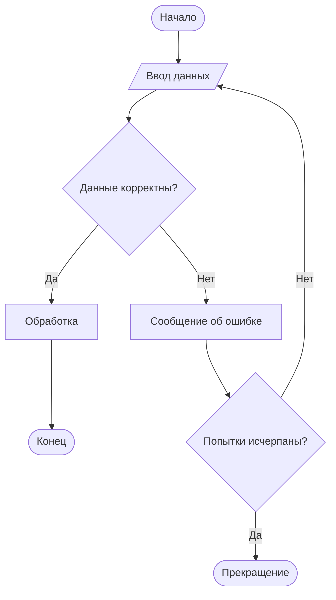

# Содержание

- [Свойства алгоритма](#свойства-алгоритма)
- [Способы задания алгоритма](#способы-задания-алгоритма)
- [Завершимость циклов](#завершимость-циклов)
- [Блок-схемы и поток управления](#блок-схемы-и-поток-управления)
- [Построение блок-схем](#построение-блок-схем)
- [Сложность алгоритма](#сложность-алгоритма)
- [Документирование и проверка](#документирование-и-проверка)
- [Жизненный цикл и надёжность](#жизненный-цикл-и-надёжность)
- [Главное](#главное)

# Алгоритмы, блок-схемы и оценка сложности

**11.11.2026 · Информатика**

## Свойства алгоритма

Алгоритм описывает действия для решения класса задач. Формальные свойства позволяют проверить, насколько определённо и воспроизводимо задано решение.

**Алгоритмизация** переводит требования предметной области в последовательность действий, пригодную для реализации. Она позволяет обсуждать логику решения отдельно от конкретного языка и платформы: одну и ту же понятную схему можно реализовать на разных языках, а затем сравнить реализацию с требованиями. Схемы также помогают согласовывать работу аналитиков и разработчиков, документировать и сопровождать решение.

| Свойство | Содержание | Пример нарушения |
|---|---|---|
| Дискретность | Решение разбито на отдельные шаги. | Действия смешаны без ясных границ. |
| Определённость | Каждый шаг и условие трактуются однозначно. | Нечёткая инструкция допускает разные действия. |
| Результативность | Процедура завершается за конечное число шагов. | Цикл не имеет достижимого выхода. |
| Массовость | Метод применим к классу допустимых задач. | Описание жёстко привязано к одному примеру. |
| Корректность | Результат соответствует спецификации. | Логическая ошибка приводит к неверному ответу. |

Конечность сама по себе не гарантирует правильности ответа: для корректности нужно соответствие результата условиям задачи.

## Способы задания алгоритма

Алгоритм представляют словесным описанием, псевдокодом, блок-схемой, формальной моделью или программным кодом. Формы решают разные задачи:

| Форма | Для чего удобна |
|---|---|
| Словесное описание | Объяснение задачи и общей последовательности действий. |
| Псевдокод | Уточнение логики и операций без привязки к конкретному языку. |
| Блок-схема | Наглядное представление потока управления и ветвлений. |
| Формальная модель | Точное описание и исследование свойств. |
| Код | Непосредственное исполнение вычислительной системой. |

Блок-схему и псевдокод полезно использовать совместно: схема показывает структуру управления, а псевдокод уточняет действия над данными.

## Завершимость циклов

Причины незавершения включают недостижимое условие выхода, неизменяющуюся переменную цикла, ожидание события без ограничения времени и взаимную блокировку.

При описании цикла нужно определить начальное состояние управляющих переменных, условие, тело и изменение состояния. Например, пропуск изменения счётчика может сделать условие выхода недостижимым.

Для обоснования завершимости применяют **вариант**, или ранжирующую функцию: величину, которая строго уменьшается на каждой итерации и не может уменьшаться бесконечно, например принимает неотрицательные целые значения. В сочетании с условием выхода это позволяет доказать конечность цикла. Дополнительно используются инварианты, ограничение числа попыток, тайм-ауты и безопасное завершение.

В цикле с **предусловием** проверка производится перед телом, поэтому возможны ноль итераций. В цикле с **постусловием** тело выполняется как минимум один раз. Для счётных циклов согласуют начальное и конечное значения, направление и величину шага. В условиях следует последовательно использовать либо условие продолжения, либо условие остановки.

Примеры конструкций в языках программирования: `while` обычно проверяет условие до тела, `do...while` — после него, а `for` часто используют для цикла со счётчиком.

## Блок-схемы и поток управления

Блок-схема представляет алгоритм как ориентированный граф: вершины соответствуют действиям и решениям, а дуги — возможным переходам управления. Путь по графу задаёт сценарий выполнения, ветвления помогают выделить тестовые случаи, а циклы показывают повторяющиеся фрагменты.

| Элемент | Обозначение | Назначение |
|---|---|---|
| Начало и конец | Скруглённый блок | Границы алгоритма. |
| Процесс | Прямоугольник | Вычисление или действие. |
| Ввод и вывод | Параллелограмм | Получение или выдача данных. |
| Решение | Ромб | Проверка условия и выбор ветви. |
| Предопределённый процесс | Прямоугольник с двойными боковыми линиями | Вызов подалгоритма. |
| Соединитель | Круг | Перенос потока без пересечения линий. |

Типичная схема проверки ввода:

## Построение блок-схем

Общие правила:

1. Явно обозначать границы алгоритма и интерфейс данных; основное направление чтения — сверху вниз.
2. Применять структурные переходы и единые термины; для большинства блоков использовать один вход и один выход.
3. Формулировать условия ясно и обозначать все исходящие ветви, например «да» и «нет».
4. В блоке процесса фиксировать одну осмысленную операцию; определять вызываемые подалгоритмы и согласованно маркировать соединители.
5. Показывать не только основной сценарий, но и некорректный ввод, отказы, тайм-ауты и превышение ограничений.

Соединители помогают переносить поток без пересечения линий. Для ввода и вывода полезно указывать источник и получатель данных; нормальное и аварийное завершение следует различать.

При проверке схемы обращают внимание на недостижимые ветви, повтор без изменения состояния, пропущенную обработку ошибок и неоднозначные переходы. По схеме должны восстанавливаться предусмотренные сценарии выполнения.

## Сложность алгоритма

**Сложность** выражает зависимость затрат ресурсов от размера входных данных $n$. Помимо времени учитывают дополнительную память, а при обращении к внешним источникам — число и характер операций ввода-вывода. Оценка позволяет сравнивать решения и прогнозировать их масштабируемость.

На типичной шкале роста при увеличении $n$ располагаются $O(1)$, $O(\log n)$, $O(n)$, $O(n\log n)$, $O(n^2)$, $O(2^n)$ и $O(n!)$.

Обозначение $O(f(n))$ задаёт асимптотическую верхнюю оценку: начиная с некоторого размера входа затраты ограничены сверху постоянным кратным $f(n)$. При сравнении алгоритмов важно уточнять, для какого случая получена оценка, например для худшего.

Практическое время зависит также от постоянных множителей, организации памяти и платформы. Если основную задержку создают сеть или база данных, сокращение обращений к внешним ресурсам может оказаться важнее ускорения отдельных вычислений. При выборе решения сопоставляют время и дополнительную память, а при изменении масштаба проверяют и модель данных.

| Конструкция | Оценка и смысл |
|---|---|
| Последовательность | $T(n)=T_1(n)+T_2(n)+\cdots$; в асимптотике доминирует наиболее быстро растущий член. |
| Ветвление | В худшем случае учитывают стоимость проверки и наиболее дорогой ветви: $T_{\max}=T_{\text{проверки}}+\max(T_1,T_2)$. |
| Цикл | При постоянной стоимости тела стоимость порядка числа итераций, умноженного на стоимость тела. |
| Вложенные циклы | Числа итераций перемножают, если границы независимы; два полных цикла по $n$ дают $O(n^2)$. |
| Деление задачи | При постоянном уменьшении размера в несколько раз число шагов может быть логарифмическим, как в бинарном поиске. |

## Документирование и проверка

**Спецификация** фиксирует предусловия, постусловия, интерфейсы данных, ограничения ресурсов и исключительные ситуации. **Трассировка** — пошаговая проверка выполнения на типовых и граничных входах с сопоставлением ожидаемого поведения.

При подготовке тестов выделяют сценарии для ветвей, циклов, исключений и граничных значений. Связь требований, схемы, реализации и тестов облегчает проверку и сопровождение.

Стандартизация нужна для однозначности, проверяемости и сопровождаемости. В проекте согласуют символы, формулировки действий и условий, перенос схемы на другие страницы и разбиение на подалгоритмы.

## Жизненный цикл и надёжность

Жизненный цикл решения включает требования, разработку алгоритма и схемы, реализацию, тестирование, эксплуатацию и последующую актуализацию. При изменении требований необходимо согласованно обновлять связанные документы, реализацию и тесты.

Надёжное решение явно предусматривает:

- проверку входных данных и обработку отказов внешних ресурсов;
- предел повторных попыток и тайм-ауты;
- контроль завершимости;
- безопасное завершение и журналирование.

Например, если задача принимает только целое число, при проверке ввода следует предусмотреть буквы, пробелы, дробные значения и данные вне допустимого диапазона. Реакция на такой ввод должна соответствовать спецификации: сообщение об ошибке, повтор или завершение.

## Главное

- Алгоритму нужны определённые шаги, применимость к классу задач, завершение и корректный результат.
- Псевдокод уточняет действия, а блок-схема показывает пути управления.
- Вариант цикла помогает обосновать завершимость; для ожиданий и повторов используют ограничения.
- Условие цикла с предусловием проверяется до тела, а с постусловием — после него.
- Сложность связывает затраты ресурсов с размером входа и помогает сравнивать решения.
- Спецификация, трассировка и тестирование связывают требования с поведением реализации.
- Исключительные ситуации и безопасное завершение должны быть предусмотрены явно.
