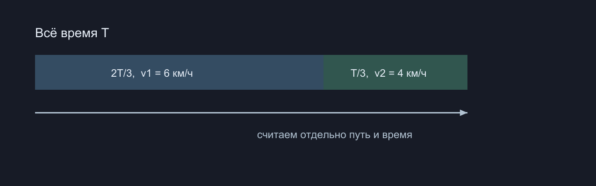
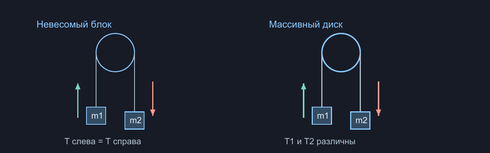
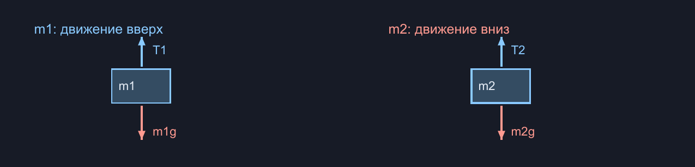
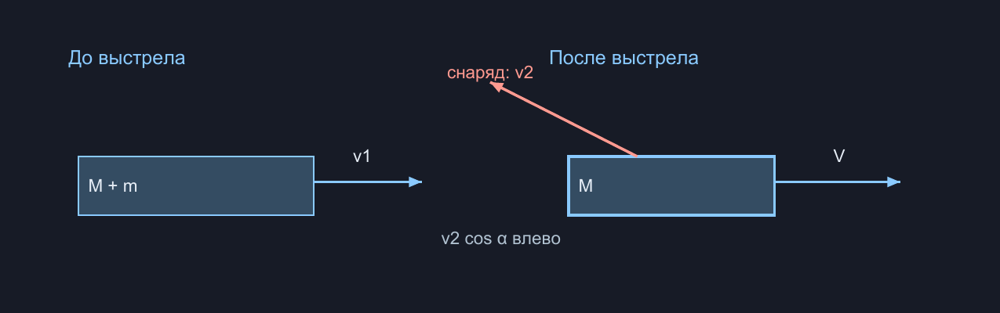
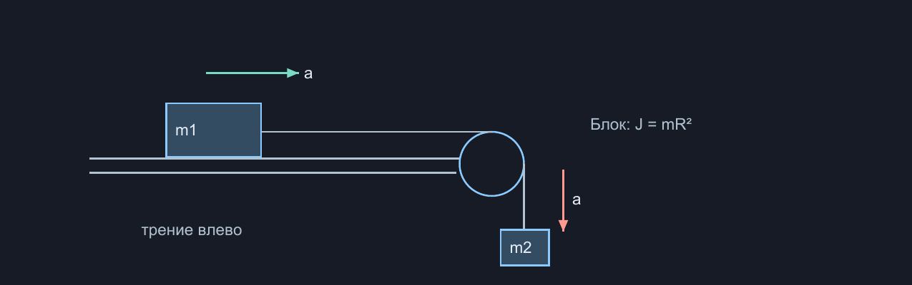

# Вариант 1А — подробный разбор задач

Во всех задачах требуется буквенный ответ. В численных примерах принято $g=9{,}8\ \text{м/с}^2$.

## Задача 1. Средняя скорость туриста

**Условие.** Турист две трети времени двигался со скоростью $v_1=6\ \text{км/ч}$, а оставшуюся часть времени — со скоростью $v_2=4\ \text{км/ч}$. Определить среднюю скорость движения за всё время.

Средняя скорость — это весь пройденный путь, делённый на всё время движения. Пусть оно равно $T$. Длительности первого и второго участков равны $2T/3$ и $T/3$. Путь на каждом участке — произведение скорости на время:

$$
s_1=v_1\frac{2T}{3},\qquad s_2=v_2\frac{T}{3}.
$$

Складываем пути и делим на $T$. Само время сокращается, поэтому знать его численное значение не нужно:

$$
v_{\text{ср}}=\frac{s_1+s_2}{T}=\frac{2v_1+v_2}{3}.
$$

$$
v_{\text{ср}}=\frac{2\cdot6+4}{3}=\frac{16}{3}\approx5{,}33\ \text{км/ч}.
$$

**Ответ:** $v_{\text{ср}}=(2v_1+v_2)/3\approx5{,}33\ \text{км/ч}$. Ответ расположен между $4$ и $6\ \text{км/ч}$ и ближе к большей скорости, поскольку с ней турист двигался дольше.

## Задача 2. Два груза на блоке

**Условие.** На нити, перекинутой через идеальный неподвижный блок, подвешены два груза массами $m_1$ и $m_2$, причём $m_2>m_1$. Найти натяжение нити. Трения нет, нить невесома и нерастяжима. Как изменится ответ, если блок заменить диском массой $m$ и радиусом $R$?

### 1. Идеальный блок

Более тяжёлый груз $m_2$ идёт вниз, а груз $m_1$ — вверх. Нерастяжимая нить придаёт грузам ускорения одинакового модуля $a$. Для идеального блока натяжение $T$ одинаково с обеих сторон. Выберем для каждого груза положительную ось по направлению его ускорения:

$$
m_2g-T=m_2a,\qquad T-m_1g=m_1a.
$$

Складываем уравнения, чтобы исключить $T$:

$$
(m_2-m_1)g=(m_1+m_2)a,
\qquad
a=\frac{(m_2-m_1)g}{m_1+m_2}.
$$

Подставляем ускорение, например, в уравнение $T=m_1(g+a)$:

$$
T=m_1g\left(1+\frac{m_2-m_1}{m_1+m_2}\right)
=\frac{2m_1m_2g}{m_1+m_2}.
$$

### 2. Блок в виде однородного диска

Диск нужно раскрутить, поэтому натяжения по обе стороны теперь различны: $T_1$ действует на груз $m_1$, $T_2$ — на груз $m_2$. Предполагаем отсутствие проскальзывания нити по диску. Его момент инерции и угловое ускорение равны

$$
J=\frac{mR^2}{2},\qquad \varepsilon=\frac{a}{R}.
$$

Разность моментов сил вращает диск. Объединим её с уравнениями грузов:

$$
(T_2-T_1)R=J\varepsilon,\qquad T_2-T_1=\frac{ma}{2};
$$

$$
m_2g-T_2=m_2a,\qquad T_1-m_1g=m_1a.
$$

Складывая три уравнения, получаем:

$$
a=\frac{(m_2-m_1)g}{m_1+m_2+m/2},\qquad
T_1=m_1(g+a),\quad T_2=m_2(g-a).
$$

Введём $D=m_1+m_2+m/2$. Натяжения непосредственно через массы:

$$
T_1=\frac{m_1g(2m_2+m/2)}{D},\qquad
T_2=\frac{m_2g(2m_1+m/2)}{D}.
$$

**Ответ:** для идеального блока $T=2m_1m_2g/(m_1+m_2)$; для диска натяжения $T_1$ и $T_2$ приведены выше. Радиус сократился. При $m\to0$ выражения переходят в результат для идеального блока.

### Почему направления и знаки именно такие

Для левого груза направим положительную ось вверх: натяжение направлено вверх, тяжесть — вниз, поэтому $T_1-m_1g=m_1a$. Для правого груза положительная ось направлена вниз: $m_2g-T_2=m_2a$.

У идеального блока $T_1=T_2=T$, и после сложения уравнений получаем $(m_2-m_1)g=(m_1+m_2)a$. У диска моменты $T_2R$ и $T_1R$ направлены противоположно. Их разность равна $J\varepsilon$, откуда $T_2-T_1=ma/2$. Добавка $m/2$ в знаменателе ускорения учитывает вращение диска. При $m_2>m_1$ имеем $a>0$ и $T_2>T_1$.

## Задача 3. Выстрел с движущейся платформы

**Условие.** Платформа с орудием массой $M=1\ \text{т}$ движется со скоростью $v_1=1\ \text{м/с}$. Снаряд массой $m=10\ \text{кг}$ вылетает под углом $\alpha=60^\circ$ к горизонту в сторону, противоположную движению платформы. Его скорость относительно земли $v_2=100\ \text{м/с}$. Найти скорость платформы после выстрела.

Направим ось $x$ вправо, по исходному движению. За короткое время выстрела горизонтальным внешним импульсом пренебрегаем: импульс системы «платформа + снаряд» по оси $x$ сохраняется. Считаем, что указанная масса $M$ — масса платформы с орудием без снаряда. До выстрела общая масса равна $M+m$.

Снаряд летит против движения, поэтому его горизонтальная скорость относительно земли равна $-v_2\cos\alpha$. Обозначая скорость платформы после выстрела через $V$, записываем:

$$
(M+m)v_1=MV-mv_2\cos\alpha.
$$

$$
V=\frac{(M+m)v_1+mv_2\cos\alpha}{M}
=v_1+\frac{m}{M}(v_1+v_2\cos\alpha).
$$

$$
V=1+\frac{10}{1000}(1+100\cos60^\circ)=1{,}51\ \text{м/с}.
$$

**Ответ:** $V=v_1+\dfrac{m}{M}(v_1+v_2\cos\alpha)=1{,}51\ \text{м/с}$, вправо. Платформа ускорилась, поскольку снаряд получил импульс влево.

Если $1\ \text{т}$ понимать как массу платформы **вместе со снарядом до выстрела**, результат будет $V=(Mv_1+mv_2\cos\alpha)/(M-m)\approx1{,}515\ \text{м/с}$.

## Задача 4. Грузы, стол и массивный блок

**Условие.** Два тела массами $m_1=0{,}25\ \text{кг}$ и $m_2=0{,}15\ \text{кг}$ связаны тонкой нитью через блок. Первое скользит по горизонтальному столу, второе висит. Коэффициент трения $\mu=0{,}2$. Масса блока $m=0{,}1\ \text{кг}$ равномерно распределена по ободу. Найти ускорение $a$ и натяжения $T_1$, $T_2$. Массой нити и трением в оси пренебречь.

Пусть груз $m_2$ опускается, а $m_1$ движется к блоку. Сила трения направлена против движения и равна $F_{\text{тр}}=\mu m_1g$. Уравнения поступательного движения:

$$
T_1-\mu m_1g=m_1a,\qquad m_2g-T_2=m_2a.
$$

Масса блока расположена по ободу, поэтому $J=mR^2$. Нить не проскальзывает: $\varepsilon=a/R$. Из уравнения моментов:

$$
(T_2-T_1)R=J\varepsilon,\qquad T_2-T_1=ma.
$$

Сложим три уравнения: обе силы натяжения сократятся, но масса блока останется в знаменателе:

$$
m_2g-\mu m_1g=(m_1+m_2+m)a,
\qquad a=\frac{g(m_2-\mu m_1)}{m_1+m_2+m}.
$$

$$
a=\frac{9{,}8(0{,}15-0{,}2\cdot0{,}25)}{0{,}25+0{,}15+0{,}1}
=1{,}96\ \text{м/с}^2.
$$

$$
T_1=m_1(a+\mu g)=0{,}98\ \text{Н},\qquad
T_2=m_2(g-a)=1{,}176\ \text{Н}.
$$

**Ответ:** $a=1{,}96\ \text{м/с}^2$, $T_1=0{,}98\ \text{Н}$, $T_2\approx1{,}18\ \text{Н}$. Направление согласуется с условиями: $m_2g>\mu m_1g$. Разность натяжений $T_2-T_1=0{,}196\ \text{Н}$ равна $ma$.

### Подробно: как исключаются натяжения

Выражаем $T_1$ из первого уравнения и $T_2$ из второго:

$$
T_1=m_1a+\mu m_1g,\qquad T_2=m_2g-m_2a.
$$

Вычитаем первое из второго и используем уравнение вращения:

$$
m_2g-m_2a-m_1a-\mu m_1g=ma,
\qquad g(m_2-\mu m_1)=a(m_1+m_2+m).
$$

Численная проверка: $F_{\text{тр}}=0{,}49\ \text{Н}$, $m_2g=1{,}47\ \text{Н}$. Разница $0{,}98\ \text{Н}$ ускоряет систему с эффективной массой $0{,}50\ \text{кг}$. По отдельности:

$$
T_1-F_{\text{тр}}=0{,}98-0{,}49=0{,}25\cdot1{,}96=0{,}49\ \text{Н},
$$

$$
m_2g-T_2=1{,}47-1{,}176=0{,}15\cdot1{,}96=0{,}294\ \text{Н},
\qquad T_2-T_1=0{,}1\cdot1{,}96=0{,}196\ \text{Н}.
$$

## Задача 5. Мяч и скамья Жуковского

**Условие.** Человек на покоящейся скамье Жуковского ловит мяч массой $m=0{,}4\ \text{кг}$, летящий горизонтально со скоростью $v=20\ \text{м/с}$. Траектория проходит на расстоянии $r=0{,}8\ \text{м}$ от оси скамьи. Момент инерции человека и скамьи $J=6\ \text{кг}\cdot\text{м}^2$. Найти угловую скорость после ловли.

Во время короткого захвата пренебрегаем моментом внешних сил относительно вертикальной оси, поэтому сохраняется момент импульса. До захвата скамья покоится; момент импульса мяча равен $mvr$, так как $r$ — кратчайшее расстояние от оси до линии движения.

После захвата скамья, человек и мяч вращаются вместе. Мяч считаем точечной массой, удерживаемой на расстоянии $r$ от оси. Поэтому к моменту инерции скамьи и человека нужно добавить $mr^2$:

$$
mvr=(J+mr^2)\omega,\qquad \omega=\frac{mvr}{J+mr^2}.
$$

$$
\omega=\frac{0{,}4\cdot20\cdot0{,}8}{6+0{,}4\cdot0{,}8^2}
=\frac{6{,}4}{6{,}256}\approx1{,}02\ \text{рад/с}.
$$

**Ответ:** $\omega=mvr/(J+mr^2)\approx1{,}02\ \text{рад/с}$. Величина $J$ в условии включает только человека и скамью, поэтому инерцию мяча добавили отдельно. Положение мяча в момент ловли на расстоянии $r$ — принятое допущение.
