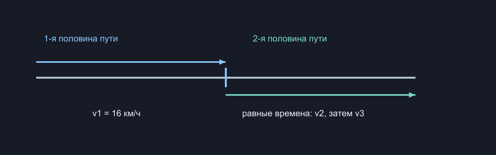
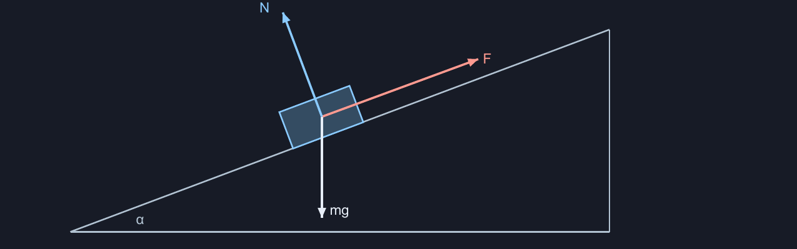
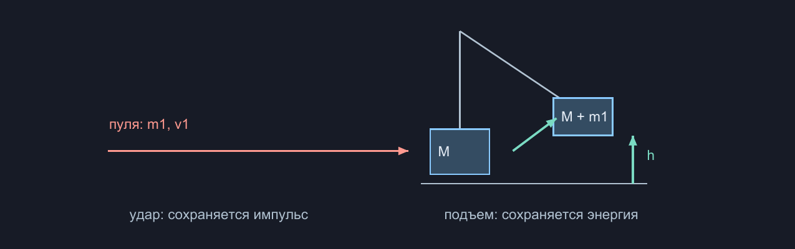
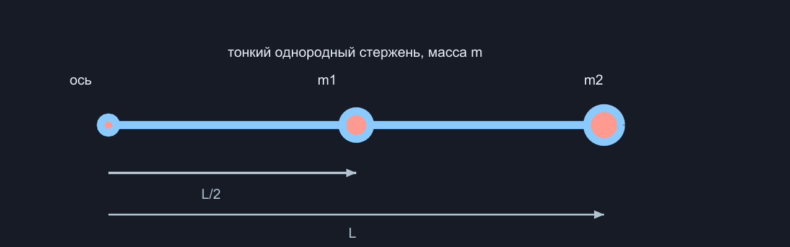
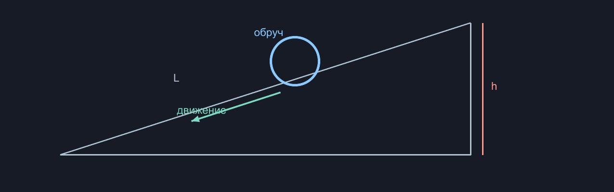

# Вариант 1Б — подробный разбор задач

Во всех задачах требуется буквенный ответ. В численных примерах принято $g=9{,}8\ \text{м/с}^2$.

## Задача 1. Средняя скорость студента

**Условие.** Студент проехал половину пути на велосипеде со скоростью $v_1=16\ \text{км/ч}$. Затем половину оставшегося времени ехал со скоростью $v_2=12\ \text{км/ч}$, а до конца пути шёл со скоростью $v_3=5\ \text{км/ч}$. Найти среднюю скорость на всём пути.

Обозначим весь путь через $S$. Первая половина пройдена за время

$$
t_1=\frac{S}{2v_1}.
$$

На оставшейся половине пути студент движется со скоростями $v_2$ и $v_3$ в течение равных промежутков. Пусть каждый равен $\tau$. Тогда сумма двух пройденных расстояний равна второй половине пути:

$$
\frac S2=v_2\tau+v_3\tau=(v_2+v_3)\tau,
\qquad \tau=\frac{S}{2(v_2+v_3)}.
$$

Это сумма расстояний за два разных промежутка, а не движение с двумя скоростями одновременно. Общее время на второй половине равно $2\tau=S/(v_2+v_3)$. Складываем времена и делим полный путь на полное время:

$$
t=\frac{S}{2v_1}+\frac{S}{v_2+v_3},\qquad
v_{\text{ср}}=\frac{S}{t}
=\frac{2v_1(v_2+v_3)}{v_2+v_3+2v_1}.
$$

$$
v_{\text{ср}}=\frac{2\cdot16(12+5)}{12+5+2\cdot16}
=\frac{544}{49}\approx11{,}10\ \text{км/ч}.
$$

**Ответ:** $v_{\text{ср}}=2v_1(v_2+v_3)/(v_2+v_3+2v_1)\approx11{,}1\ \text{км/ч}$. Простое арифметическое среднее трёх скоростей здесь не подходит: времена на всех трёх участках не одинаковы.

## Задача 2. Брусок на наклонной плоскости

**Условие.** Брусок массы $m$ равномерно движется вверх по наклонной плоскости, образующей угол $\alpha=30^\circ$ с горизонтом. Определить силу, приложенную к бруску вдоль плоскости. Трения нет.

Выберем ось $x$ вдоль плоскости вверх. Сила $F$ направлена вдоль этой оси, сила тяжести $mg$ — вертикально вниз. Её проекция вдоль плоскости равна $-mg\sin\alpha$, а перпендикулярная составляющая — $mg\cos\alpha$.

Синус появляется потому, что проекция тяжести вдоль поверхности — катет напротив угла $\alpha$ в треугольнике разложения силы. Скорость постоянна, значит $a=0$ и сумма проекций сил на ось плоскости равна нулю:

$$
F-mg\sin\alpha=0,\qquad F=mg\sin\alpha.
$$

При $\alpha=30^\circ$ синус равен $1/2$. Числовая масса не задана, поэтому ответ остаётся буквенным.

**Ответ:** $F=mg\sin\alpha=mg/2$.

Проверка: при $\alpha=0$ формула даёт $F=0$, а при $\alpha=90^\circ$ — $F=mg$.

## Задача 3. Баллистический маятник

**Условие.** Пуля массой $m_1=9\ \text{г}$, летящая со скоростью $v_1=500\ \text{м/с}$, попала в баллистический маятник — груз на лёгком подвесе массой $M=6\ \text{кг}$ — и застряла в нём. На какую высоту поднимется маятник после удара?

### 1. Разделяем удар и подъём

Примем стандартную схему: до удара нить вертикальна, пуля летит горизонтально. Пуля застревает, поэтому удар неупругий. За короткое время удара сохраняется **горизонтальная** составляющая импульса; вертикальный импульс подвеса этому не мешает. Механическая энергия при ударе не сохраняется.

Пусть сразу после удара маятник и пуля движутся с общей скоростью $u$. Если груз до удара покоился,

$$
m_1v_1=(M+m_1)u,\qquad u=\frac{m_1v_1}{M+m_1}.
$$

### 2. Маятник поднимается после удара

Во время последующего подъёма пренебрегаем сопротивлением. В верхней точке скорость на мгновение равна нулю, кинетическая энергия переходит в потенциальную:

$$
\frac{(M+m_1)u^2}{2}=(M+m_1)gh,\qquad
h=\frac{u^2}{2g}=\frac{m_1^2v_1^2}{2g(M+m_1)^2}.
$$

Переводим массу: $m_1=9\ \text{г}=0{,}009\ \text{кг}$. Тогда

$$
u=\frac{0{,}009\cdot500}{6+0{,}009}\approx0{,}749\ \text{м/с},\qquad
h\approx0{,}0286\ \text{м}=2{,}86\ \text{см}.
$$

**Ответ:** $h=m_1^2v_1^2/[2g(M+m_1)^2]\approx2{,}86\ \text{см}$ при горизонтальном полёте пули и вертикальной нити в момент удара.

В исходном тексте направление полёта не указано. Если пуля летит под углом $\theta$ к горизонту при вертикальной нити в момент удара, следует использовать горизонтальную составляющую $v_1\cos\theta$; приведённая высота умножается на $\cos^2\theta$. Без угла единственный численный ответ не определяется.

### Почему нельзя сохранять механическую энергию при ударе

Горизонтальный импульс до удара принадлежит только пуле:

$$
p_{\text{до}}=m_1v_1=0{,}009\cdot500=4{,}5\ \text{кг}\cdot\text{м/с}.
$$

Общая масса после удара равна $6{,}009\ \text{кг}$, поэтому $6{,}009u=4{,}5$ и $u\approx0{,}7489\ \text{м/с}$. Энергии же существенно различаются:

$$
E_{\text{до}}=\frac{m_1v_1^2}{2}=1125\ \text{Дж},\qquad
E_{\text{после}}=\frac{(M+m_1)u^2}{2}\approx1{,}685\ \text{Дж}.
$$

Разница переходит в деформацию, нагрев и звук. Уже после удара энергия $1{,}685\ \text{Дж}$ превращается в потенциальную энергию подъёма:

$$
h=\frac{1{,}685}{6{,}009\cdot9{,}8}\approx0{,}0286\ \text{м}=2{,}86\ \text{см}.
$$

Высота отсчитывается от начального до высшего положения маятника.

## Задача 4. Стержень с двумя шарами

**Условие.** Тонкий однородный стержень массой $m=100\ \text{г}$ и длиной $L=80\ \text{см}$ несёт два шара массами $m_1=400\ \text{г}$ и $m_2=300\ \text{г}$. Первый закреплён на середине стержня, второй — на конце. Ось вращения перпендикулярна стержню и проходит через его свободный конец. Шары считать материальными точками. Найти момент инерции $J$.

Момент инерции системы равен сумме моментов её частей относительно одной оси. Для однородного стержня относительно оси через конец $J_{\text{ст}}=mL^2/3$. Шары считаем точками и используем $J=mr^2$:

$$
J_1=m_1\left(\frac L2\right)^2,\qquad J_2=m_2L^2.
$$

$$
J=\frac{mL^2}{3}+\frac{m_1L^2}{4}+m_2L^2
=L^2\left(\frac m3+\frac{m_1}{4}+m_2\right).
$$

В единицах СИ $m=0{,}1\ \text{кг}$, $m_1=0{,}4\ \text{кг}$, $m_2=0{,}3\ \text{кг}$, $L=0{,}8\ \text{м}$. Следовательно,

$$
J=0{,}8^2\left(\frac{0{,}1}{3}+\frac{0{,}4}{4}+0{,}3\right)
\approx0{,}277\ \text{кг}\cdot\text{м}^2.
$$

**Ответ:** $J=L^2(m/3+m_1/4+m_2)\approx0{,}277\ \text{кг}\cdot\text{м}^2$. Расстояние до оси входит в квадрате, поэтому более удалённый шар даёт больший вклад.

### Откуда берётся формула для стержня

Масса распределена равномерно: на единицу длины приходится $m/L$. Для элемента длиной $dx$ на расстоянии $x$ от оси масса $dm=(m/L)dx$, а вклад в момент инерции $dJ=x^2dm$. Интегрируем от оси до противоположного конца:

$$
J_{\text{ст}}=\frac mL\int_0^Lx^2\,dx
=\frac mL\left[\frac{x^3}{3}\right]_0^L
=\frac{mL^2}{3}.
$$

Проверим все вклады отдельно:

$$
J_{\text{ст}}=\frac{0{,}1\cdot0{,}8^2}{3}\approx0{,}02133\ \text{кг}\cdot\text{м}^2,
$$

$$
J_1=0{,}4\cdot0{,}4^2=0{,}064,\qquad J_2=0{,}3\cdot0{,}8^2=0{,}192\quad(\text{кг}\cdot\text{м}^2),
$$

$$
J=0{,}02133+0{,}064+0{,}192\approx0{,}27733\ \text{кг}\cdot\text{м}^2.
$$

Вклады положительны. Формула $J=mL^2/12$ здесь не применяется: она относится к оси через центр стержня, а здесь ось проходит через конец.

## Задача 5. Обруч скатывается со склона

**Условие.** Сколько времени потребуется обручу, чтобы скатиться без скольжения из состояния покоя с наклонной плоскости длиной $L=2\ \text{м}$ и высотой $h=10\ \text{см}$?

Пусть $\alpha$ — угол наклона. Геометрически $\sin\alpha=h/L$. Для обруча $J=mR^2$; качение без скольжения связывает скорость и угловую скорость: $v=\omega R$.

При спуске из покоя потенциальная энергия переходит в две формы кинетической энергии:

$$
mgh=\frac{mv^2}{2}+\frac{J\omega^2}{2}
=\frac{mv^2}{2}+\frac{mv^2}{2}=mv^2.
$$

Отсюда скорость внизу $v=\sqrt{gh}$. Ускорение постоянно, поскольку угол и силы постоянны. Для равноускоренного движения из покоя средняя скорость равна $v/2$, поэтому

$$
L=\frac v2t,\qquad t=\frac{2L}{v}=\frac{2L}{\sqrt{gh}}.
$$

При $h=0{,}10\ \text{м}$ получаем

$$
t=\frac{2\cdot2}{\sqrt{9{,}8\cdot0{,}10}}\approx4{,}04\ \text{с}.
$$

**Ответ:** $t=2L/\sqrt{gh}\approx4{,}04\ \text{с}$. Масса и радиус обруча сокращаются; увеличение высоты делает склон круче и уменьшает время.
