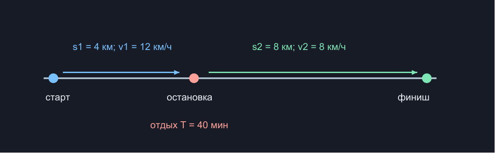
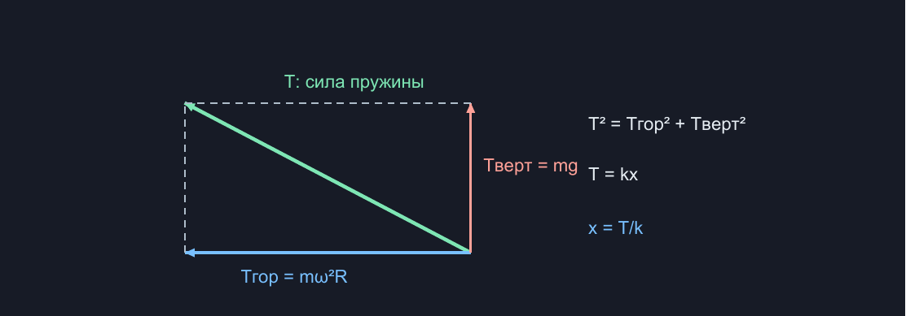
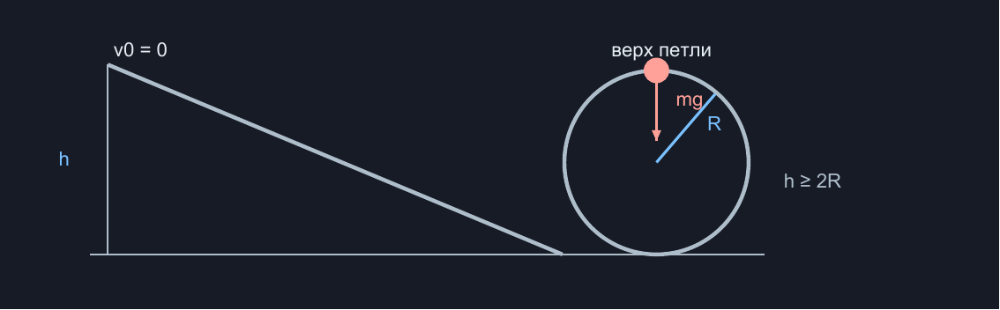
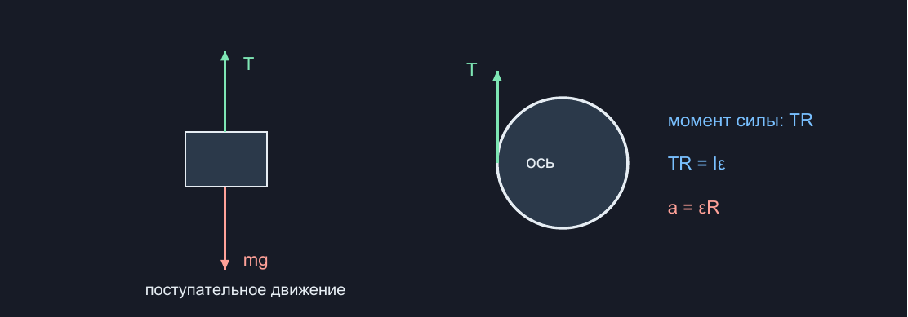
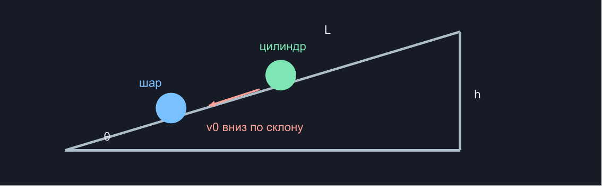
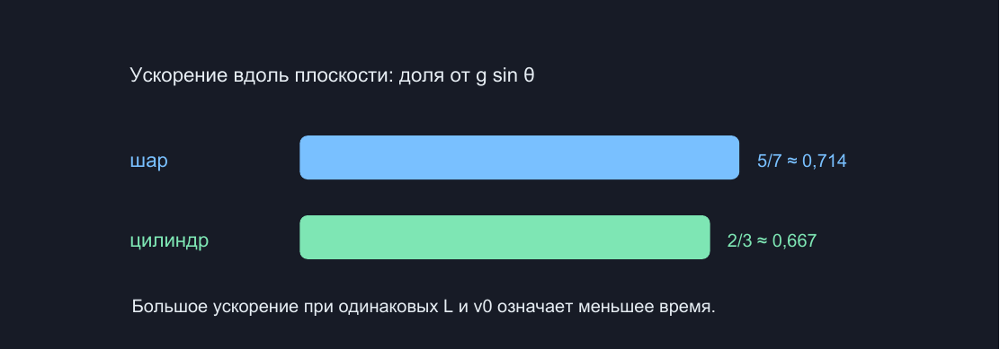

# Вариант 1В — подробные решения

Во всех задачах приведён буквенный ответ. В расчётах, где требуется численное значение, принято $g=9{,}8\ \text{м/с}^2$.

## Задача 1. Средняя скорость велосипедиста

**Условие.** Велосипедист проехал $s_1=4\ \text{км}$ со скоростью $v_1=12\ \text{км/ч}$, затем отдыхал $T=40\ \text{мин}$. Оставшиеся $s_2=8\ \text{км}$ он проехал со скоростью $v_2=8\ \text{км/ч}$. Найти среднюю скорость за весь путь.

Время отдыха на исходном фото читается не вполне чётко; в расчёте принято **40 минут**.

### 1. Из чего складывается средняя скорость

Средняя скорость за всю поездку — это весь пройденный путь, делённый на **всё** затраченное время. Во время отдыха путь не растёт, но время идёт:

$$
v_{\text{ср}}=\frac{s_1+s_2}{t_1+T+t_2}.
$$

### 2. Находим продолжительность каждого участка

$$
t_1=\frac{s_1}{v_1}=\frac{4}{12}=\frac13\ \text{ч},\qquad
t_2=\frac{s_2}{v_2}=\frac88=1\ \text{ч}.
$$

Переводим минуты в часы: $T=40/60=2/3\ \text{ч}$. Полное расстояние равно $12\ \text{км}$, полное время — $1/3+2/3+1=2\ \text{ч}$.

### 3. Составляем буквенный и численный ответы

$$
\boxed{v_{\text{ср}}=\frac{s_1+s_2}{s_1/v_1+T+s_2/v_2}
=\frac{12}{2}=6\ \text{км/ч}.}
$$

Остановка увеличивает знаменатель и поэтому уменьшает среднюю скорость за всю поездку.

## Задача 2. Груз на вращающейся пружине

**Условие.** Груз массой $m$ подвешен на пружине жёсткости $k$ и вращается в горизонтальной плоскости с постоянной угловой скоростью $\omega$ по окружности радиуса $R$. Найти растяжение $x$ пружины.

Примем пружину невесомой и подчиняющейся закону Гука, груз — точечным, а движение — установившимся.

### 1. Почему при постоянной скорости есть ускорение

Модуль скорости постоянен, но её направление непрерывно меняется. Поэтому ускорение направлено к оси вращения:

$$
v=\omega R,\qquad a_{\text{ц}}=\frac{v^2}{R}=\omega^2R.
$$

### 2. Разложим силу упругости

Обозначим модуль силы пружины через $T$. Вертикальное ускорение отсутствует, поэтому её вертикальная составляющая компенсирует вес. Горизонтальная составляющая направлена к оси и обеспечивает центростремительное ускорение:

$$
T_{\text{верт}}=mg,\qquad T_{\text{гор}}=ma_{\text{ц}}=m\omega^2R.
$$

Составляющие взаимно перпендикулярны. По теореме Пифагора:

$$
\begin{aligned}
T^2&=T_{\text{верт}}^2+T_{\text{гор}}^2\\
&=(mg)^2+(m\omega^2R)^2\\
&=m^2\left(g^2+\omega^4R^2\right),\\
T&=m\sqrt{g^2+\omega^4R^2}.
\end{aligned}
$$

### 3. Применяем закон Гука

Сила пружины $T=kx$, где $x$ — **увеличение длины**, а не полная длина пружины. Следовательно,

$$
\boxed{x=\frac{T}{k}=\frac{m}{k}\sqrt{g^2+\omega^4R^2}.}
$$

При $R=0$ горизонтальная составляющая исчезает, и получается обычное статическое растяжение $mg/k$.

## Задача 3. Тележка в мёртвой петле

**Условие.** Тележка с человеком стартует из покоя на высоте $h$ и движется по желобу с петлёй радиуса $R=6\ \text{м}$. Найти минимальную высоту, с которой тележка не оторвётся от желоба в верхней точке петли. Высота отсчитывается от нижней точки.

### 1. Граница сохранения контакта

В верхней точке центр петли находится внизу. Туда направлены сила тяжести $mg$ и реакция желоба $N$. Их сумма обеспечивает нормальное ускорение:

$$
mg+N=\frac{mv_{\text{верх}}^2}{R}.
$$

На границе отрыва $N=0$. Если скорость была бы меньше, для сохранения контакта реакция должна была бы стать отрицательной: желобу пришлось бы притягивать тележку. Значит,

$$
mg=\frac{mv_{\text{верх}}^2}{R},\qquad v_{\text{верх}}^2=gR.
$$

### 2. Сохраняем энергию

Верхняя точка петли находится на высоте $2R$. Начальная потенциальная энергия превращается в потенциальную и кинетическую энергию наверху:

$$
mgh=mg(2R)+\frac{mv_{\text{верх}}^2}{2}.
$$

Подставим предельную скорость и сократим $mg$:

$$
h_{\min}=2R+\frac{R}{2}=\frac{5R}{2}
=\frac{5\cdot6}{2}=15\ \text{м}.
$$

**Ответ:** $\boxed{h_{\min}=5R/2=15\ \text{м}}$.

Здесь пренебрегаем сопротивлением и вращательной энергией колёс. При наличии потерь потребуется бо́льшая высота.

## Задача 4. Разматывающийся цилиндр

**Условие.** На цилиндр намотана тонкая невесомая нерастяжимая лента, конец которой закреплён. Цилиндр опускается под действием тяжести. Найти ускорение оси, если цилиндр: 1) сплошной; 2) полый тонкостенный.

### 1. Поступательное движение

Вниз действует $mg$, вверх — натяжение ленты $T$. Ось $y$ направим вниз. Уравнение движения центра масс:

$$
mg-T=ma.
$$

Одного уравнения пока недостаточно: в нём две неизвестные, $T$ и $a$.

### 2. Вращение и связь ускорений

Сила тяжести проходит через центр и не создаёт момента относительно него. Лента тянет по касательной на плече $R$, её момент равен $TR$. При разматывании без проскальзывания:

$$
TR=I\varepsilon,\qquad a=\varepsilon R,\qquad \varepsilon=\frac aR.
$$

Здесь $a$ — ускорение центра цилиндра. Подставим связь ускорений в уравнение моментов:

$$
TR=I\frac aR,\qquad T=\frac{Ia}{R^2}.
$$

### 3. Исключаем натяжение

$$
\begin{aligned}
mg-\frac{Ia}{R^2}&=ma,\\
mg&=a\left(m+\frac{I}{R^2}\right),\\
a&=\boxed{\frac{g}{1+I/(mR^2)}}.
\end{aligned}
$$

### 4. Подставляем моменты инерции

Для однородного сплошного цилиндра $I_{\text{спл}}=mR^2/2$, для тонкостенного полого $I_{\text{пол}}=mR^2$. Поэтому

$$
\boxed{a_{\text{спл}}=\frac{g}{1+1/2}=\frac{2g}{3}
\approx6{,}53\ \text{м/с}^2},
$$

$$
\boxed{a_{\text{пол}}=\frac{g}{1+1}=\frac g2
=4{,}90\ \text{м/с}^2}.
$$

Оба ускорения меньше $g$: часть энергии идёт на вращение. Сопротивлением воздуха и массой ленты пренебрегаем.

## Задача 5. Шар и цилиндр на склоне

**Условие.** Однородные шар и сплошной цилиндр одинаковой массы и одинакового радиуса скатываются без проскальзывания по плоскости длиной $L$ и высотой $h$. Их одинаковую скорость $v_0$, направленную вдоль плоскости, считаем **начальной скоростью вниз**. Сравнить времена скатывания.

### 1. Общее ускорение при качении

Обозначим угол плоскости через $\theta$, тогда $\sin\theta=h/L$. Сила трения $f$ направлена вверх по склону и создаёт момент, который раскручивает тело. Записываем поступательное и вращательное движения и условие отсутствия скольжения:

$$
mg\sin\theta-f=ma,\qquad fR=I\varepsilon,\qquad a=\varepsilon R.
$$

Из двух последних равенств $f=Ia/R^2$. Подставляем:

$$
mg\sin\theta=ma+\frac{Ia}{R^2},\qquad
\boxed{a=\frac{g\sin\theta}{1+I/(mR^2)}}.
$$

### 2. Находим ускорения

Моменты инерции однородных тел:

$$
I_{\text{ш}}=\frac25mR^2,\qquad I_{\text{ц}}=\frac12mR^2.
$$

Тогда

$$
a_{\text{ш}}=\frac{g(h/L)}{1+2/5}=\frac{5gh}{7L},\qquad
a_{\text{ц}}=\frac{g(h/L)}{1+1/2}=\frac{2gh}{3L}.
$$

У шара ускорение больше: $5/7>2/3$. При одинаковом начальном движении и пути он доедет раньше.

### 3. Переходим от ускорений к временам

При постоянном ускорении конечная скорость после пути $L$ и средняя скорость равны

$$
v_{\text{кон}}=\sqrt{v_0^2+2aL},\qquad v_{\text{ср}}=\frac{v_0+v_{\text{кон}}}{2}.
$$

Отсюда время движения:

$$
t=\frac{L}{v_{\text{ср}}}=\frac{2L}{v_0+\sqrt{v_0^2+2aL}}.
$$

Подставляя два ускорения, получаем **буквенный ответ**:

$$
\boxed{\frac{t_{\text{ц}}}{t_{\text{ш}}}=
\frac{v_0+\sqrt{v_0^2+10gh/7}}{v_0+\sqrt{v_0^2+4gh/3}}.}
$$

Цилиндр скатывается дольше. Если дополнительно $v_0=0$, выражение упрощается:

$$
\frac{t_{\text{ц}}}{t_{\text{ш}}}
=\sqrt{\frac{a_{\text{ш}}}{a_{\text{ц}}}}
=\sqrt{\frac{5/7}{2/3}}=\sqrt{\frac{15}{14}}\approx1{,}035.
$$

При ненулевой начальной скорости численное отношение зависит от $v_0$ и $h$; универсального числа из данных нет.

