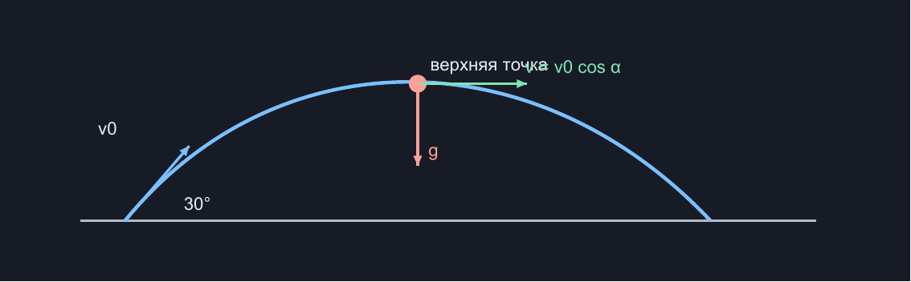
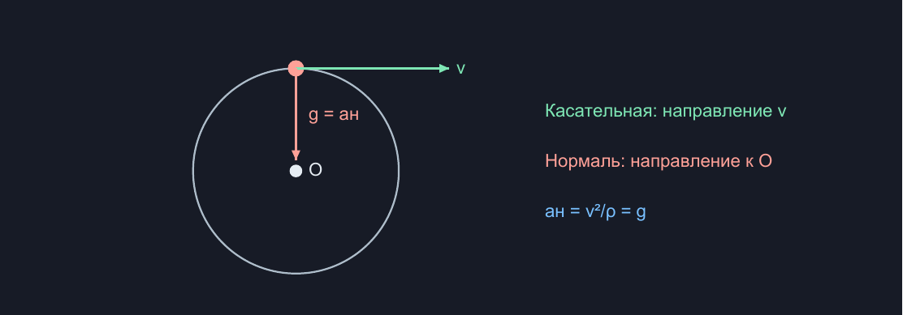
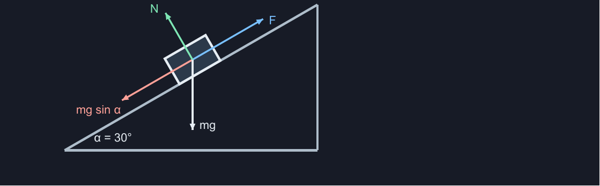
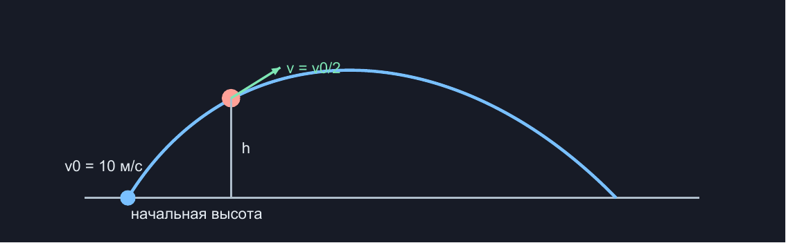
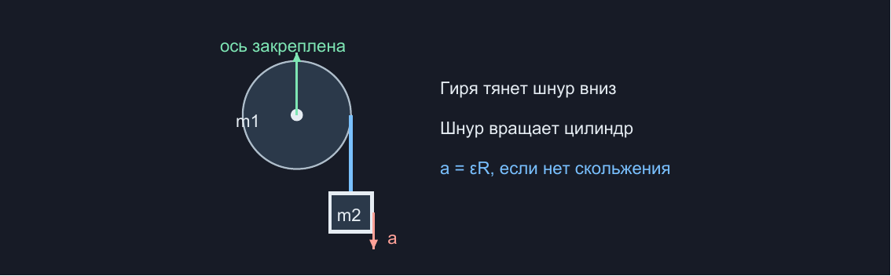
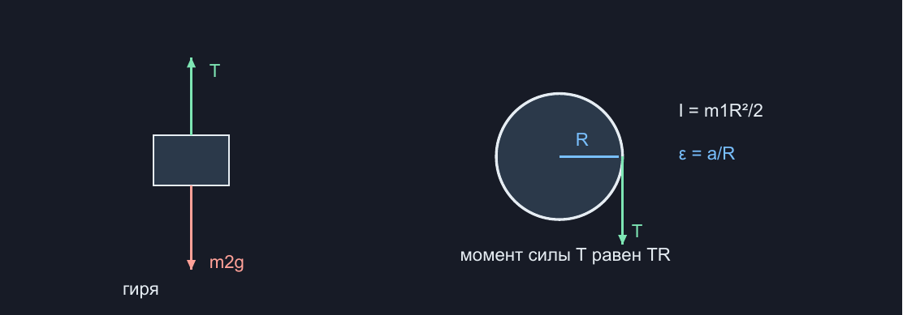
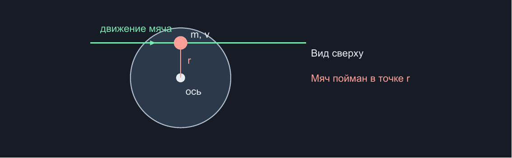
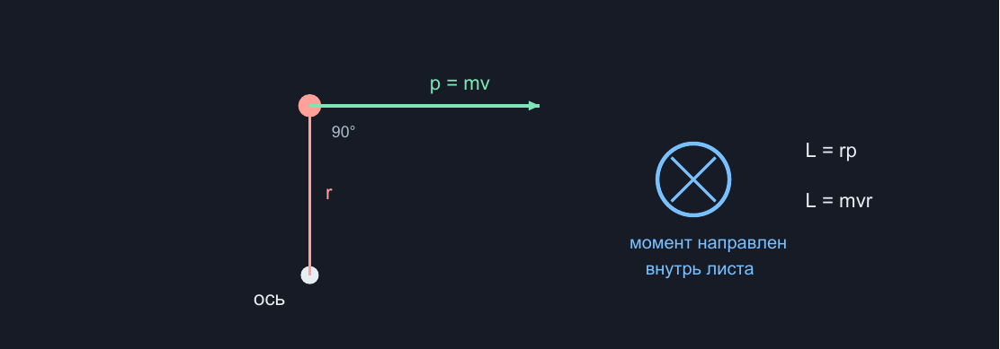

# Вариант 1Г — подробные решения

Во всех задачах приведён буквенный ответ. В численных расчётах используем $g=9{,}8\ \text{м/с}^2$.

## Задача 1. Радиус кривизны траектории

**Условие.** Тело брошено со скоростью $v_0=15\ \text{м/с}$ под углом $\alpha=30^\circ$ к горизонту. Пренебрегая сопротивлением воздуха, определить радиус кривизны траектории в верхней точке.

### 1. Что такое радиус кривизны

В малой окрестности заданной точки траекторию можно приблизить касающейся окружностью. Её радиус обозначают $\rho$; центр этой окружности расположен по нормали к траектории. Связь скорости и нормального ускорения:

$$
a_n=\frac{v^2}{\rho}.
$$

### 2. Направления скорости и ускорения

При отсутствии сопротивления горизонтальная составляющая скорости постоянна. В верхней точке вертикальная составляющая равна нулю, поэтому скорость горизонтальна:

$$
v=v_x=v_0\cos\alpha.
$$

Ускорение свободного падения направлено вертикально вниз и перпендикулярно скорости. Значит, в этой точке всё ускорение — нормальное: $a_n=g$, а касательная составляющая $a_\tau=0$.

### 3. Находим радиус

$$
g=\frac{v^2}{\rho}
\quad\Longrightarrow\quad
\boxed{\rho=\frac{v^2}{g}=\frac{v_0^2\cos^2\alpha}{g}}.
$$

Для заданного угла $\cos^230^\circ=(\sqrt3/2)^2=3/4$:

$$
\rho=\frac{15^2\cdot(3/4)}{9{,}8}
=\frac{168{,}75}{9{,}8}\approx17{,}2\ \text{м}.
$$

Единицы согласуются: $(\text{м}^2/\text{с}^2)/(\text{м}/\text{с}^2)=\text{м}$. При $g=10\ \text{м/с}^2$ получится примерно $16{,}9\ \text{м}$.

## Задача 2. Равномерное движение бруска вверх

**Условие.** Брусок массы $m$ движется вверх по плоскости, образующей угол $\alpha=30^\circ$ с горизонтом, с постоянной скоростью. Сила $F$ приложена вдоль плоскости, трения нет. Найти модуль силы $F$.

### 1. Выбираем ось

Направим ось $x$ вверх вдоль склона. Поскольку скорость постоянна, ускорение равно нулю. Вдоль плоскости сила $F$ направлена вверх, а составляющая силы тяжести $mg\sin\alpha$ — вниз. Перпендикулярная составляющая компенсируется реакцией $N$.

Проекция второго закона Ньютона:

$$
\sum F_x=F-mg\sin\alpha=ma_x=0.
$$

### 2. Выражаем силу

$$
F=mg\sin\alpha.
$$

При $\alpha=30^\circ$ имеем $\sin30^\circ=1/2$. Числовой массы в условии нет:

$$
\boxed{F=mg\sin30^\circ=\frac{mg}{2}.}
$$

Вдоль плоскости компенсируется составляющая силы тяжести, а не весь вес $mg$.

## Задача 3. Высота, на которой скорость уменьшится вдвое

**Условие.** Камень брошен со скоростью $v_0=10\ \text{м/с}$ под углом $\alpha>60^\circ$ к горизонту. Пренебрегая сопротивлением воздуха, найти высоту, на которой скорость камня станет равна $v_0/2$.

### 1. Применяем закон сохранения энергии

Отсчитываем высоту $h$ от точки броска. Потеря кинетической энергии идёт на увеличение потенциальной:

$$
\frac{mv_0^2}{2}=\frac{mv^2}{2}+mgh.
$$

Сокращаем массу и выражаем $h$:

$$
h=\frac{v_0^2-v^2}{2g}.
$$

### 2. Подставляем половину скорости

При $v=v_0/2$:

$$
h=\frac{v_0^2-v_0^2/4}{2g}
=\boxed{\frac{3v_0^2}{8g}}.
$$

Для $v_0=10\ \text{м/с}$ и $g=9{,}8\ \text{м/с}^2$:

$$
h=\frac{3\cdot10^2}{8\cdot9{,}8}=\frac{300}{78{,}4}
\approx3{,}83\ \text{м}.
$$

### 3. Зачем указан угол

Горизонтальная скорость не меняется: $v_x=v_0\cos\alpha$. При $\alpha>60^\circ$ она меньше $v_0/2$, поэтому искомая скорость достижима. Найденная высота встречается и при подъёме, и при спуске.

Угол влияет на то, **достижимо ли** уменьшение скорости вдвое, но в формулу высоты не входит: изменение полной кинетической энергии определяется изменением высоты.

## Задача 4. Гиря разматывает шнур на валу

**Условие.** Вал в виде однородного сплошного цилиндра массой $m_1=10\ \text{кг}$ закреплён на горизонтальной оси. На цилиндр намотан шнур, к концу которого подвешена гиря массой $m_2=2\ \text{кг}$. Найти ускорение гири.

Будем считать шнур невесомым и нерастяжимым, проскальзывание шнура и трение в оси отсутствующими.

### 1. Второй закон Ньютона для гири

На гирю действуют вес $m_2g$ вниз и натяжение $T$ вверх. Положительное направление выбираем вниз:

$$
m_2g-T=m_2a.
$$

### 2. Уравнение вращения вала

Натяжение создаёт относительно оси момент $TR$. Для сплошного однородного цилиндра $I=m_1R^2/2$. Поскольку шнур не скользит, $\varepsilon=a/R$:

$$
TR=I\varepsilon=\frac{m_1R^2}{2}\frac aR
=\frac{m_1Ra}{2}.
$$

Делим на $R$:

$$
T=\frac{m_1a}{2}.
$$

### 3. Исключаем натяжение

$$
\begin{aligned}
m_2g-\frac{m_1a}{2}&=m_2a,\\
m_2g&=a\left(m_2+\frac{m_1}{2}\right),\\
a&=\boxed{\frac{m_2g}{m_2+m_1/2}}.
\end{aligned}
$$

Радиус сократился. Слагаемое $m_1/2$ учитывает инерцию вращающегося вала. Подставим числа:

$$
a=\frac{2g}{2+10/2}=\frac{2g}{7}=2{,}80\ \text{м/с}^2.
$$

Гиря ускоряется медленнее свободного падения, потому что одновременно раскручивает вал.

## Задача 5. Мяч и скамья Жуковского

**Условие.** Человек на покоящейся скамье ловит мяч массой $m=0{,}4\ \text{кг}$, летящий горизонтально со скоростью $v=20\ \text{м/с}$. Траектория мяча проходит на расстоянии $r=0{,}8\ \text{м}$ от вертикальной оси. Момент инерции человека и скамьи $J=6\ \text{кг·м}^2$. Найти угловую скорость после поимки.

**Допущение:** мяч пойман и удерживается на расстоянии $r$ от оси; его размеры малы. Внешним моментом относительно оси пренебрегаем.

### 1. Момент импульса до поимки

Импульс мяча $p=mv$. Кратчайшее расстояние от оси до прямой движения — плечо импульса $r$, поэтому момент импульса относительно оси по модулю равен

$$
L_{\text{нач}}=rp=mvr.
$$

Скамья до поимки покоится и своего начального момента импульса не даёт.

### 2. Момент импульса после поимки

Мяч вращается вместе с человеком и скамьёй. Его вклад в момент инерции равен $mr^2$, поэтому

$$
J_{\text{после}}=J+mr^2,\qquad
L_{\text{кон}}=(J+mr^2)\omega.
$$

### 3. Закон сохранения момента импульса

При отсутствии внешнего момента относительно оси $L_{\text{нач}}=L_{\text{кон}}$:

$$
mvr=(J+mr^2)\omega,
\qquad\boxed{\omega=\frac{mvr}{J+mr^2}}.
$$

Вычислим отдельно числитель и знаменатель:

$$
mvr=0{,}4\cdot20\cdot0{,}8=6{,}4\ \text{кг·м}^2/\text{с},
$$

$$
J+mr^2=6+0{,}4\cdot0{,}8^2=6{,}256\ \text{кг·м}^2.
$$

Следовательно,

$$
\boxed{\omega=\frac{6{,}4}{6{,}256}\approx1{,}02\ \text{рад/с}.}
$$

Поимка неупругая: часть кинетической энергии переходит во внутреннюю. Поэтому для определения угловой скорости используем сохранение момента импульса, а не сохранение кинетической энергии. Вклад пойманного мяча в момент инерции учтён.

