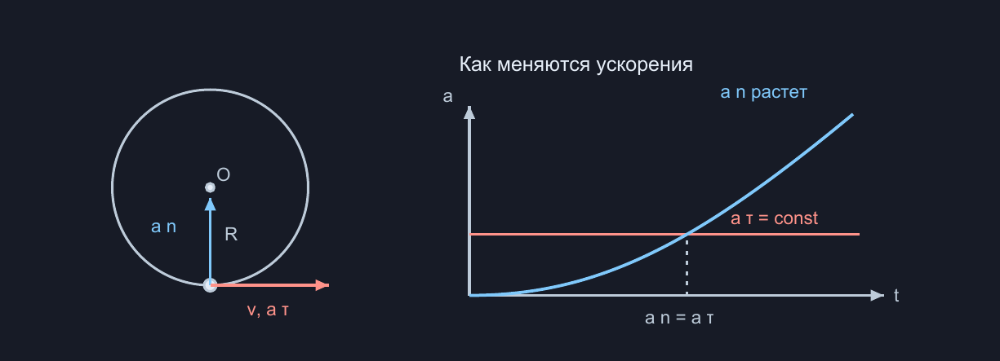
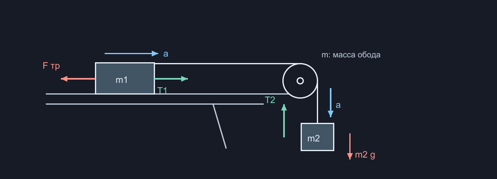
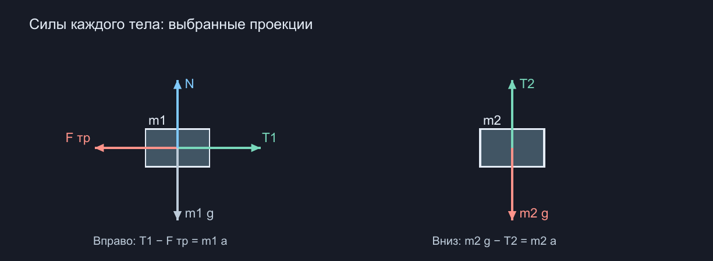
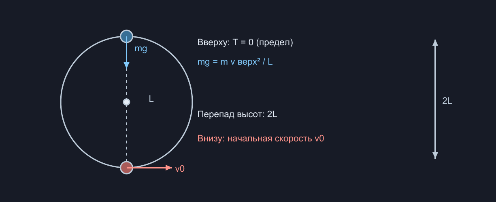
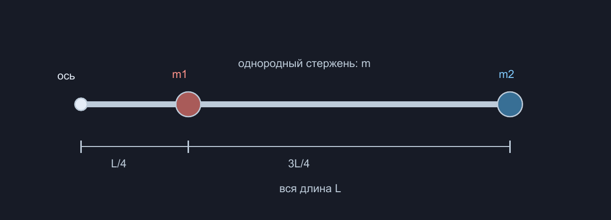
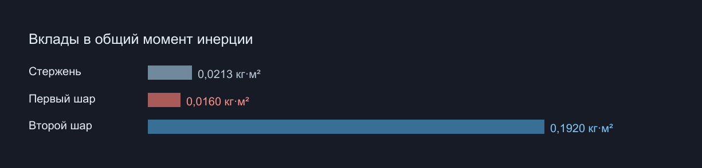
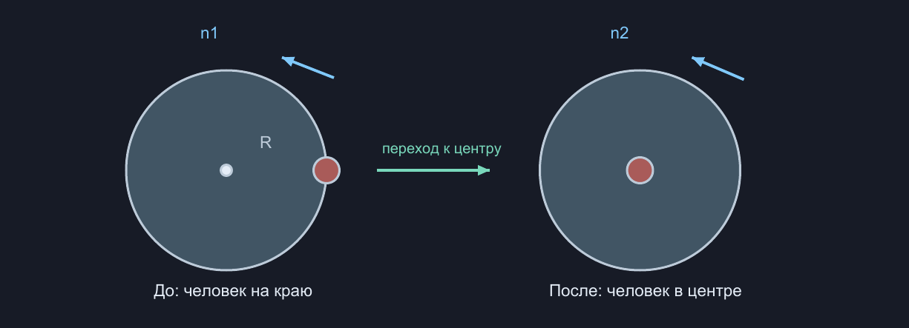

# Вариант 1Д — подробный разбор

## Задача 1. Ускорения на окружности

**Условие.** Материальная точка начинает движение по окружности радиуса $R = 0{,}6\,\text{м}$ с тангенциальным ускорением $a_{\tau} = 1\,\text{м}/\text{с}^2$. Через какое время модули тангенциального и нормального ускорений станут равны?

Тангенциальное ускорение меняет скорость по величине, а нормальное направлено к центру и поворачивает вектор скорости. На графике пересечение кривых показывает искомый момент; график **качественный, не в масштабе**.

### 1. Выражаем скорость и нормальное ускорение

Будем считать, что точка начинает движение из покоя: $v_0 = 0$. Тангенциальное ускорение постоянно, поэтому

$$
v = a_{\tau}t.
$$

Для движения по окружности нормальное ускорение равно $a_n = v^2/R$. Подставим выражение скорости:

$$
a_n = \frac{(a_{\tau}t)^2}{R}
    = \frac{a_{\tau}^{\,2}t^2}{R}.
$$

### 2. Приравниваем ускорения

$$
\frac{a_{\tau}^{\,2}t^2}{R} = a_{\tau},
\qquad
t^2 = \frac{R}{a_{\tau}},
\qquad
t = \sqrt{\frac{R}{a_{\tau}}}.
$$

Берём положительный корень: время после начала движения неотрицательно.

$$
t = \sqrt{\frac{0{,}6}{1}}
  = \sqrt{0{,}6}
  \approx 0{,}775\,\text{с}.
$$

**Ответ:** $\displaystyle t = \sqrt{\frac{R}{a_{\tau}}} \approx 0{,}775\,\text{с}$.

Проверка размерности: $R/a_{\tau}$ измеряется в $\text{м}/(\text{м}/\text{с}^2) = \text{с}^2$, поэтому после извлечения корня получаем секунды.

---

## Задача 2. Два груза и массивный блок

**Условие.** Грузы $m_1 = 0{,}25\,\text{кг}$ и $m_2 = 0{,}15\,\text{кг}$ соединены нитью через блок массой $m = 0{,}001\,\text{кг}$. Первый груз скользит по столу с коэффициентом трения $\mu = 0{,}2$; второй висит. Масса блока распределена по ободу. Найти ускорение $a$ и натяжения $T_1$, $T_2$. Массой нити и трением в оси пренебречь.

Нить считаем нерастяжимой и не скользящей по блоку. Её участки имеют одинаковый модуль ускорения $a$; блок при этом вращается.

### 1. Выбираем положительные направления и находим трение

Для $m_1$ выберем направление вправо, к блоку, а для $m_2$ — вниз. На первом грузе по вертикали $N = m_1g$. Модуль силы трения:

$$
F_{\text{тр}} = \mu N = \mu m_1g.
$$

Трение направлено против движения. В выбранном направлении разность движущей силы тяжести и трения $m_2g - \mu m_1g$ положительна, поскольку

$$
0{,}15 > 0{,}2 \cdot 0{,}25 = 0{,}05.
$$

При движении из покоя это согласуется с направлением на рисунке.

### 2. Уравнения поступательного движения

Для тела на столе натяжение $T_1$ тянет вправо, трение действует влево. Для висящего груза тяжесть действует вниз, натяжение $T_2$ — вверх:

$$
T_1 - \mu m_1g = m_1a,
\qquad
m_2g - T_2 = m_2a.
$$

Натяжения по разные стороны блока нельзя заранее считать равными: их разность создаёт вращающий момент.

### 3. Связываем вращение блока с движением нити

Пусть радиус блока равен $R$, а угловое ускорение — $\varepsilon$. Момент сил натяжения относительно его оси равен $(T_2 - T_1)R$. Для обода $J = mR^2$, а без проскальзывания $a = \varepsilon R$. Закон вращательного движения даёт:

$$
(T_2 - T_1)R = J\varepsilon
              = mR^2\frac{a}{R},
\qquad
T_2 - T_1 = ma.
$$

Радиус сократился: при данной модели блока его численное значение не нужно. Если бы блок был сплошным диском, формула момента инерции и результат изменились бы.

### 4. Решаем три уравнения

Из уравнений грузов:

$$
T_1 = m_1a + \mu m_1g,
\qquad
T_2 = m_2g - m_2a.
$$

Подставляя их разность в уравнение блока, получаем:

$$
m_2g - m_2a - m_1a - \mu m_1g = ma.
$$

Собираем слагаемые с ускорением и выражаем $a$:

$$
g(m_2 - \mu m_1) = a(m_1 + m_2 + m),
\qquad
a = \frac{g(m_2 - \mu m_1)}{m_1 + m_2 + m}.
$$

После этого находим натяжения:

$$
T_1 = m_1(a + \mu g),
\qquad
T_2 = m_2(g - a).
$$

### 5. Подстановка при $g = 9{,}8\,\text{м}/\text{с}^2$

$$
a = 9{,}8\cdot
\frac{0{,}15 - 0{,}2\cdot0{,}25}{0{,}25 + 0{,}15 + 0{,}001}
\approx 2{,}444\,\text{м}/\text{с}^2,
$$

$$
T_1 = 0{,}25\cdot(2{,}444 + 0{,}2\cdot9{,}8)
\approx 1{,}101\,\text{Н},
$$

$$
T_2 = 0{,}15\cdot(9{,}8 - 2{,}444)
\approx 1{,}103\,\text{Н}.
$$

**Ответ:** $a \approx 2{,}44\,\text{м}/\text{с}^2$; $T_1 \approx 1{,}101\,\text{Н}$; $T_2 \approx 1{,}103\,\text{Н}$.

Проверка: $T_2 - T_1 = ma \approx 0{,}00244\,\text{Н}$; натяжения близки, потому что масса блока мала.

---

## Задача 3. Шарик на нити в вертикальной плоскости

**Условие.** Шарик подвешен на невесомой нерастяжимой нити длиной $L = 2\,\text{м}$. Какую минимальную скорость нужно сообщить шарику, чтобы он описал окружность в вертикальной плоскости? Сопротивлением воздуха пренебречь.

Начальная точка — нижнее положение равновесия, скорость направлена по касательной. Нить должна оставаться натянутой; самая критичная точка — верхняя.

### 1. Условие движения в верхней точке

В верхней точке к центру окружности, то есть вниз, направлены сила тяжести $mg$ и сила натяжения нити $T$. Они создают необходимое центростремительное ускорение:

$$
mg + T = \frac{mv_{\text{верх}}^2}{L}.
$$

Нить может тянуть, но не может толкать: $T \ge 0$. Поэтому в предельном случае минимальной скорости $T = 0$, и

$$
\frac{v_{\text{верх}}^2}{L} = g,
\qquad
v_{\text{верх}}^2 = gL.
$$

### 2. Почему нельзя взять в верхней точке скорость ноль

Для движения по окружности вверху нужно нормальное ускорение $v^2/L$, направленное к центру. Если скорость там слишком мала, необходимое натяжение по уравнению вышло бы отрицательным, а нить не способна его создать. Она провиснет, и описанная окружность не получится.

### 3. Сохраняем механическую энергию

Возьмём нулевую потенциальную энергию внизу. В верхней точке шарик поднялся на $2L$, значит прибавка потенциальной энергии равна $mg\cdot 2L$. До и после подъёма:

$$
\frac{mv_0^2}{2}
= \frac{mv_{\text{верх}}^2}{2} + mg\cdot 2L.
$$

Умножим равенство на $2/m$ и подставим предельное значение $v_{\text{верх}}^2 = gL$:

$$
v_0^2 = v_{\text{верх}}^2 + 4gL = 5gL,
\qquad
v_{0\min} = \sqrt{5gL}.
$$

### 4. Вычисление и проверка

$$
v_{0\min} = \sqrt{5\cdot9{,}8\cdot2}
           = \sqrt{98}
           \approx 9{,}90\,\text{м}/\text{с}.
$$

**Ответ:** $v_{0\min} = \sqrt{5gL} \approx 9{,}9\,\text{м}/\text{с}$.

При $g = 10\,\text{м}/\text{с}^2$ получится ровно $10\,\text{м}/\text{с}$. Предельное значение соответствует $T = 0$ в верхней точке; если требуется строго положительное натяжение всюду, скорость должна быть чуть больше $\sqrt{5gL}$.

Проверка размерности: $gL$ имеет размерность $(\text{м}/\text{с}^2)\cdot\text{м} = \text{м}^2/\text{с}^2$; квадратный корень — скорость.

---

## Задача 4. Стержень и два шарика

**Условие.** Однородный тонкий стержень массой $m = 100\,\text{г}$ и длиной $L = 80\,\text{см}$. Первый шар массой $m_1 = 400\,\text{г}$ находится на расстоянии $L/4$ от свободного конца, второй массой $m_2 = 300\,\text{г}$ — на другом конце. Ось перпендикулярна стержню и проходит через свободный конец. Шары считать материальными точками. Найти момент инерции $J$.

Расстояния измеряются от оси: до первого шара — $L/4$, до второго — $L$. Масса стержня распределена по всей длине, поэтому весь стержень нельзя заменять точкой на конце.

### 1. Складываем вклады

Момент инерции системы равен сумме моментов её частей относительно одной и той же оси. Для материальной точки $J = mr^2$, а для однородного стержня вокруг конца $J_{\text{ст}} = mL^2/3$. Таким образом:

$$
\begin{aligned}
J &= J_{\text{ст}} + J_1 + J_2 \\
  &= \frac{mL^2}{3} + m_1\left(\frac{L}{4}\right)^2 + m_2L^2 \\
  &= L^2\left(\frac{m}{3} + \frac{m_1}{16} + m_2\right).
\end{aligned}
$$

### 2. Откуда берётся коэффициент $1/3$

Возьмём элемент стержня $dm = (m/L)\,dx$ на расстоянии $x$ от оси. Его вклад $dJ = x^2dm$. Интегрируя по всей длине, получаем

$$
J_{\text{ст}} = \frac{m}{L}\int_0^L x^2\,dx
= \frac{m}{L}\cdot\frac{L^3}{3}
= \frac{mL^2}{3}.
$$

### 3. Переводим исходные данные в СИ

$$
m = 0{,}100\,\text{кг},\quad
m_1 = 0{,}400\,\text{кг},\quad
m_2 = 0{,}300\,\text{кг},\quad
L = 0{,}80\,\text{м}.
$$

$$
r_1 = L/4 = 0{,}20\,\text{м},
\qquad
r_2 = L = 0{,}80\,\text{м}.
$$

### 4. Вычисляем вклады по отдельности

$$
\begin{aligned}
J_{\text{ст}} &= 0{,}100\cdot0{,}80^2/3 \approx 0{,}02133\,\text{кг}\cdot\text{м}^2,\\
J_1 &= 0{,}400\cdot0{,}20^2 = 0{,}016\,\text{кг}\cdot\text{м}^2,\\
J_2 &= 0{,}300\cdot0{,}80^2 = 0{,}192\,\text{кг}\cdot\text{м}^2.
\end{aligned}
$$

$$
J = 0{,}02133 + 0{,}016 + 0{,}192
  \approx 0{,}22933\,\text{кг}\cdot\text{м}^2.
$$

**Ответ:** $\displaystyle J = L^2\left(\frac{m}{3} + \frac{m_1}{16} + m_2\right) \approx 0{,}229\,\text{кг}\cdot\text{м}^2$.

Проверка смысла: второй шар даёт наибольший вклад, так как находится в четыре раза дальше первого; расстояние входит в момент инерции в квадрате.

---

## Задача 5. Человек на вращающейся платформе

**Условие.** Человек массой $m = 60\,\text{кг}$ стоит на краю круглой однородной платформы массой $M = 120\,\text{кг}$. Платформа вращается с частотой $n_1 = 12\,\text{мин}^{-1}$ вокруг неподвижной вертикальной оси. Человек переходит к центру. Найти частоту $n_2$; человека считать точечной массой.

При переходе к центру человек уменьшает момент инерции системы. Внешний момент сил относительно оси считаем пренебрежимо малым, поэтому сохраняется момент импульса.

### 1. Записываем моменты инерции

Пусть радиус платформы равен $R$. Для однородного диска $J_{\text{пл}} = MR^2/2$. Сначала человек находится на краю и добавляет $mR^2$. В центре его расстояние от оси равно нулю, и его вклад равен нулю:

$$
J_1 = \frac{MR^2}{2} + mR^2,
\qquad
J_2 = \frac{MR^2}{2}.
$$

### 2. Используем сохранение момента импульса

Угловая скорость $\omega = 2\pi n$. До и после перехода система вращается как единое целое, поэтому

$$
J_1\omega_1 = J_2\omega_2,
\qquad
\frac{n_2}{n_1} = \frac{J_1}{J_2}.
$$

### 3. Находим частоту после перехода

$$
n_2 = n_1\frac{MR^2/2 + mR^2}{MR^2/2}.
$$

Радиус сокращается, поэтому знать его численное значение не требуется:

$$
n_2 = n_1\left(1 + \frac{2m}{M}\right).
$$

$$
n_2 = 12\left(1 + \frac{2\cdot60}{120}\right)
    = 12\cdot2
    = 24\,\text{мин}^{-1}.
$$

**Ответ:** $\displaystyle n_2 = n_1\left(1 + \frac{2m}{M}\right) = 24\,\text{мин}^{-1}$.

### 4. Проверяем физический смысл

Изначально момент инерции человека $mR^2$ равен моменту инерции платформы $MR^2/2$, поскольку $m = M/2$. Значит, суммарный момент инерции уменьшается ровно вдвое. Для сохранения момента импульса частота увеличивается вдвое — с $12$ до $24$ оборотов в минуту.

При этом механическая энергия вращения не обязана сохраняться: человек совершает работу мышцами при перемещении к центру. Сохраняется именно момент импульса, поскольку внешний момент относительно оси принят равным нулю.

