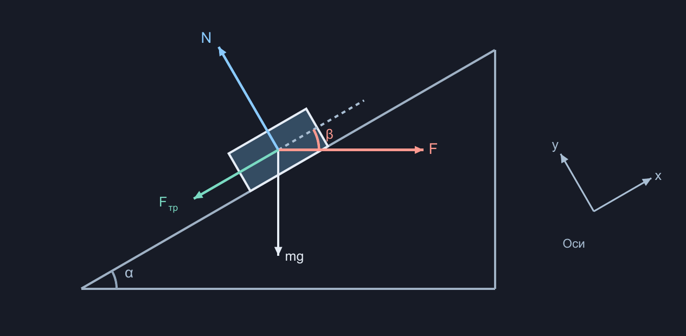
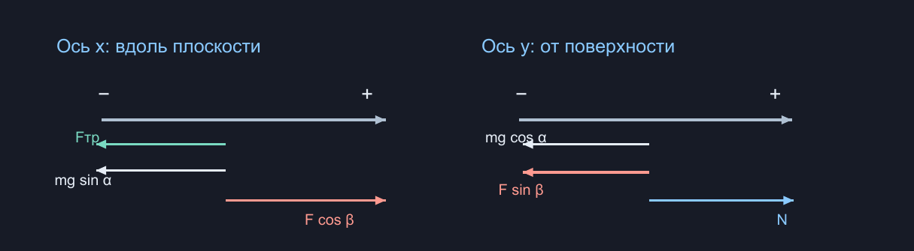
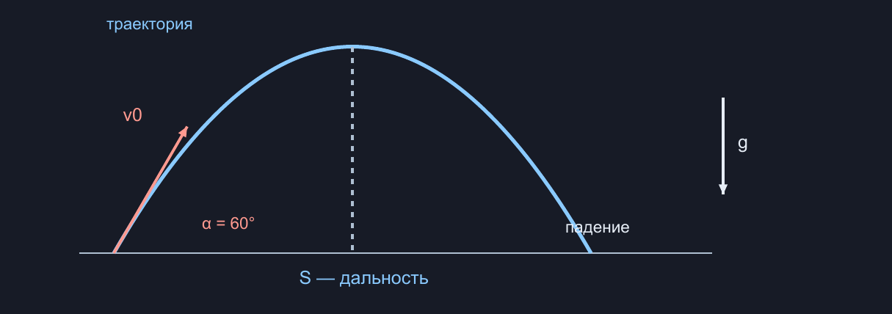
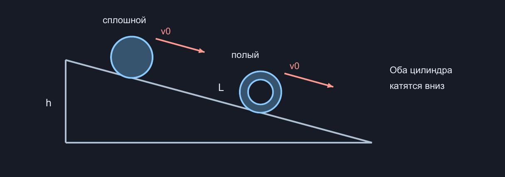
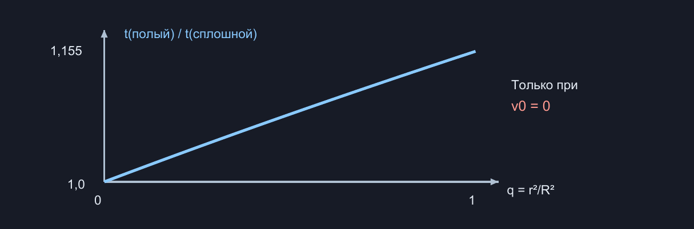

# Вариант 1Е — подробные решения

В этом варианте использованы две составляющие ускорения, второй закон Ньютона, законы сохранения, момент инерции и уравнение движения при качении. Каждая схема сопровождается пояснением о том, какие величины на ней показаны.

---

## Задача 1. Движение по окружности

**Условие.** Материальная точка начинает движение по окружности радиусом $R=0{,}6\,\text{м}$ с тангенциальным ускорением $a_{\tau}=1\,\text{м/с}^2$. Найти отношение нормального и тангенциального ускорений через $t=2\,\text{с}$ после начала движения.

**Дано:** $R=0{,}6\,\text{м}$, $a_{\tau}=1\,\text{м/с}^2$, $t=2\,\text{с}$. Найти $a_n/a_{\tau}$.

На рисунке показан один момент движения. Тангенциальное ускорение $a_{\tau}$ направлено по касательной и меняет **модуль** скорости. Нормальное ускорение $a_n$ направлено к центру окружности и меняет **направление** скорости. На схеме $a_{\tau}$ направлено в сторону движения.

### 1. Находим скорость

Считаем, что точка начинает движение из покоя, то есть $v_0=0$, а заданное тангенциальное ускорение постоянно. Тогда

$$
v=v_0+a_{\tau}t=a_{\tau}t
  =1\cdot2=2\,\text{м/с}.
$$

### 2. Находим нормальное ускорение

Для движения по окружности модуль нормального ускорения связан со скоростью и радиусом:

$$
a_n=\frac{v^2}{R}
    =\frac{2^2}{0{,}6}
    \approx6{,}67\,\text{м/с}^2.
$$

### 3. Получаем буквенный и численный ответ

Сначала подставим $v=a_{\tau}t$ и лишь затем сократим множители:

$$
\frac{a_n}{a_{\tau}}
=\frac{(a_{\tau}t)^2}{R\,a_{\tau}}
=\frac{a_{\tau}t^2}{R}.
$$

$$
\frac{a_n}{a_{\tau}}
=\frac{1\cdot2^2}{0{,}6}
=\frac{20}{3}
\approx6{,}67.
$$

**Ответ:** $\displaystyle \frac{a_n}{a_{\tau}}=\frac{a_{\tau}t^2}{R}\approx6{,}67$. Отношение безразмерно: оба ускорения измеряются в $\text{м/с}^2$.

На графике синяя линия показывает рост $a_n$ со временем, а красная — постоянное $a_{\tau}$. Запись $a_n=g$, встречавшаяся в исходном рисунке ниже основного решения, относится только к особой ситуации и для этой задачи не нужна.

---

## Задача 2. Ящик на наклонной плоскости

**Условие.** По шероховатой наклонной плоскости под углом $\alpha=30^\circ$ равномерно толкают вверх ящик массой $m=20\,\text{кг}$, прикладывая силу $F=150\,\text{Н}$ под углом $\beta=30^\circ$ к плоскости. Найти модуль силы, с которой ящик давит на поверхность.

**Дано:** $m=20\,\text{кг}$, $\alpha=30^\circ$, $\beta=30^\circ$, $F=150\,\text{Н}$. В основном расчёте возьмём $g=9{,}8\,\text{м/с}^2$.

На схеме сила $F$ направлена вверх вдоль плоскости и одновременно прижимает ящик к ней. Такое направление показано и в предоставленном разборе. Поскольку здесь $\alpha=\beta=30^\circ$, в этом конкретном рисунке сила $F$ направлена горизонтально.

### 1. Выбираем оси и рассматриваем силы

Направим ось $x$ вверх вдоль плоскости, а ось $y$ — перпендикулярно плоскости, от поверхности.

- Сила тяжести $mg$ направлена вертикально вниз.
- Реакция поверхности $N$ направлена от плоскости.
- Приложенная сила $F$ направлена вверх по склону и к поверхности.
- Сила трения $F_{\text{тр}}$ направлена против движения, вниз по склону.

Ящик движется равномерно, поэтому сумма проекций сил на каждую ось равна нулю.

### 2. Записываем проекцию вдоль плоскости

Вверх по плоскости действует $F\cos\beta$, а вниз — сила трения и составляющая тяжести $mg\sin\alpha$:

$$
F\cos\beta-F_{\text{тр}}-mg\sin\alpha=0.
$$

Для давления на поверхность сила трения не нужна, но это равенство позволяет проверить движение вдоль склона.

### 3. Записываем проекцию перпендикулярно плоскости

От поверхности направлена сила $N$. К поверхности направлены $mg\cos\alpha$ и $F\sin\beta$. Поэтому

$$
N-mg\cos\alpha-F\sin\beta=0,
\qquad
N=mg\cos\alpha+F\sin\beta.
$$

Реакция поверхности действует **на ящик**. Сила давления $P$ действует со стороны ящика **на поверхность**. По третьему закону Ньютона их модули равны, а направления противоположны:

$$
\boxed{P=N=mg\cos\alpha+F\sin\beta}.
$$

### 4. Подставляем значения

Так как $\cos30^\circ=\sqrt3/2$ и $\sin30^\circ=1/2$,

$$
\begin{aligned}
P
&=20\cdot9{,}8\cdot\frac{\sqrt3}{2}
  +150\cdot\frac12\\
&\approx169{,}7+75
=244{,}7\,\text{Н}.
\end{aligned}
$$

**Ответ при силе, прижимающей ящик к плоскости:** $\boxed{P=mg\cos\alpha+F\sin\beta\approx245\,\text{Н}}$.

### 5. Проверка и другие допущения

Вдоль плоскости $F\cos\beta\approx129{,}9\,\text{Н}$, а $mg\sin\alpha=98\,\text{Н}$. Равномерному движению соответствует сила трения примерно $31{,}9\,\text{Н}$ вниз по плоскости.

Если силу направить под тем же углом **от поверхности**, она будет уменьшать давление:

$$
P=mg\cos\alpha-F\sin\beta\approx94{,}7\,\text{Н}.
$$

При этом само условие не уточняет сторону наклона силы; приведённая схема выбирает направление **к поверхности**. В присланном разборе также уточнено значение $F=150\,\text{Н}$. Если взять школьное приближение $g=10\,\text{м/с}^2$, первый ответ составит

$$
P=100\sqrt3+75\approx248{,}2\,\text{Н}.
$$

---

## Задача 3. Дальность полёта снаряда

**Условие.** Снаряд массой $m=5\,\text{кг}$ бросают под углом $\alpha=60^\circ$ к горизонту, совершая при этом работу $A=500\,\text{Дж}$. Пренебрегая сопротивлением воздуха, определить дальность полёта снаряда.

**Дано:** $m=5\,\text{кг}$, $\alpha=60^\circ$, $A=500\,\text{Дж}$. Для расчёта $g=9{,}8\,\text{м/с}^2$. Найти дальность $S$.

Считаем, что снаряд до броска покоился, совершённая работа сообщила ему кинетическую энергию, а приземление произошло на высоте броска.

### 1. По работе находим начальную скорость

По теореме об изменении кинетической энергии:

$$
A=\frac{mv_0^2}{2},\qquad
v_0^2=\frac{2A}{m},\qquad
v_0=\sqrt{\frac{2A}{m}}.
$$

$$
v_0=\sqrt{\frac{2\cdot500}{5}}
=10\sqrt2
\approx14{,}14\,\text{м/с}.
$$

### 2. По вертикальному движению находим время полёта

Отсчитаем высоту $y$ от точки броска вверх:

$$
y=v_0\sin\alpha\cdot t-\frac{gt^2}{2}.
$$

При падении $y=0$. Получаем корень $t=0$, соответствующий броску, и второй корень — время полёта:

$$
t_{\text{пол}}=\frac{2v_0\sin\alpha}{g}.
$$

### 3. По горизонтальной скорости находим дальность

Горизонтальная скорость постоянна: $v_x=v_0\cos\alpha$. Поэтому

$$
\begin{aligned}
S&=v_0\cos\alpha\cdot t_{\text{пол}}\\
 &=\frac{2v_0^2\sin\alpha\cos\alpha}{g}
  =\frac{v_0^2\sin2\alpha}{g}
  =\frac{2A\sin2\alpha}{mg}.
\end{aligned}
$$

$$
S=\frac{2\cdot500\cdot\sin120^\circ}{5\cdot9{,}8}
=\frac{100\sqrt3}{9{,}8}
\approx17{,}7\,\text{м}.
$$

**Ответ:** $\boxed{S=\dfrac{2A\sin2\alpha}{mg}\approx17{,}7\,\text{м}}$.

Если конечная высота отличается от начальной, понадобится дополнительное условие о высоте точки падения.

---

## Задача 4. Момент инерции кольца

**Условие.** Найти момент инерции $J$ кольца массой $m=50\,\text{г}$, внутренним радиусом $R_1=10\,\text{см}$ и внешним радиусом $R_2=15\,\text{см}$ относительно оси, проходящей через его центр и перпендикулярной плоскости кольца.

**Дано в СИ:** $m=0{,}050\,\text{кг}$, $R_1=0{,}10\,\text{м}$, $R_2=0{,}15\,\text{м}$. Считаем кольцо плоским и однородным.

На рисунке кольцо показано сверху: ось вращения проходит через центр $O$ перпендикулярно плоскости рисунка.

### 1. Разбиваем кольцо на тонкие окружности

Момент инерции определяется выражением

$$
J=\int r^2\,dm.
$$

Для тонкой полоски радиуса $r$ и толщины $dr$ площадь равна $dS=2\pi r\,dr$. Обозначим поверхностную плотность через $\sigma$. Тогда

$$
dm=\sigma\,dS=2\pi\sigma r\,dr,
\qquad
dJ=r^2\,dm=2\pi\sigma r^3\,dr.
$$

### 2. Интегрируем от внутреннего радиуса до внешнего

$$
J=2\pi\sigma\int_{R_1}^{R_2}r^3\,dr
=\frac{\pi\sigma}{2}\left(R_2^4-R_1^4\right).
$$

Полная масса кольца равна

$$
m=\sigma\pi\left(R_2^2-R_1^2\right).
$$

Подставляем $\sigma$ и используем разложение разности квадратов:

$$
\begin{aligned}
J&=\frac{m}{2}
\frac{R_2^4-R_1^4}{R_2^2-R_1^2}\\
&=\frac{m}{2}\left(R_1^2+R_2^2\right).
\end{aligned}
$$

При одинаковой ширине $dr$ внешний участок даёт больший вклад: он содержит больше массы и находится дальше от оси. Приращение пропорционально $r^3\,dr$.

### 3. Вычисляем в единицах СИ

$$
J=\frac{0{,}050}{2}\left(0{,}10^2+0{,}15^2\right)
=0{,}025\cdot0{,}0325
=0{,}0008125\,\text{кг}\cdot\text{м}^2.
$$

**Ответ:** $\boxed{J=\dfrac{m}{2}\left(R_1^2+R_2^2\right)=8{,}125\cdot10^{-4}\,\text{кг}\cdot\text{м}^2}$.

---

## Задача 5. Качение двух цилиндров

**Условие.** Полый и сплошной цилиндры из одного материала, одинаковой массы и одинакового радиуса скатываются без проскальзывания с наклонной плоскости длиной $L$ и высотой $h$ с одинаковой скоростью $v_0$, направленной вдоль плоскости. Определить, во сколько раз отличаются их времена скатывания.

Будем считать, что $v_0$ — одинаковая **начальная** скорость цилиндров вниз по плоскости. Угол наклона обозначим $\theta$, внешний радиус обоих цилиндров — $R$, внутренний радиус полого — $r$. Тогда $\sin\theta=h/L$.

Цилиндры нарисованы для сравнения; отверстие полого цилиндра показано белым.

### 1. Получаем ускорение при качении

Вдоль плоскости составляющая тяжести $mg\sin\theta$ направлена вниз, сила трения $f$ — вверх. Второй закон Ньютона для центра масс:

$$
mg\sin\theta-f=ma.
$$

Трение создаёт вращающий момент относительно центра:

$$
fR=J\varepsilon.
$$

При качении без проскальзывания $a=\varepsilon R$. Поэтому

$$
f=\frac{Ja}{R^2}.
$$

Подставляем $f$ в уравнение поступательного движения и выражаем ускорение:

$$
mg\sin\theta
=a\left(m+\frac{J}{R^2}\right),
\qquad
a=\frac{g\sin\theta}{1+J/(mR^2)}.
$$

### 2. Сравниваем моменты инерции и ускорения

Для однородного сплошного цилиндра

$$
J_{\text{с}}=\frac{mR^2}{2}.
$$

Для однородного полого цилиндра с внутренним радиусом $r$ и внешним радиусом $R$

$$
J_{\text{п}}=\frac{m(R^2+r^2)}{2}.
$$

Обозначим $q=r^2/R^2$. С учётом $\sin\theta=h/L$ получаем

$$
a_{\text{с}}=\frac{2gh}{3L},
\qquad
a_{\text{п}}=\frac{2gh}{L(3+q)}.
$$

Если $r>0$, то $q>0$ и $a_{\text{п}}<a_{\text{с}}$. При одинаковой начальной скорости и одинаковом пути полый цилиндр движется дольше.

### 3. Выражаем время и сравниваем

Движение равноускоренное. Для каждого цилиндра

$$
L=v_0t+\frac{at^2}{2}.
$$

Берём положительный корень и умножаем числитель и знаменатель на сопряжённое выражение:

$$
t=\frac{\sqrt{v_0^2+2aL}-v_0}{a}
=\frac{2L}{v_0+\sqrt{v_0^2+2aL}}.
$$

Подставляем ускорения двух цилиндров и делим время полого цилиндра на время сплошного:

$$
\boxed{
\frac{t_{\text{п}}}{t_{\text{с}}}
=\frac{v_0+\sqrt{v_0^2+4gh/3}}
       {v_0+\sqrt{v_0^2+4gh/(3+q)}},
\qquad q=\frac{r^2}{R^2}.
}
$$

**Ответ:** полый цилиндр скатывается дольше; отношение времён дано формулой выше.

### 4. Почему нельзя получить единственное число

Внутренний радиус полого цилиндра и значения $h$, $L$, $v_0$ не заданы. Тонкая стенка также не оговорена. Поэтому единственного численного отношения времён из условия не получить. В итоговую формулу $L$ не входит, но входят $v_0$ и $h$.

Если дополнительно считать полый цилиндр тонкостенным, то $r\approx R$, $q\approx1$:

$$
\frac{t_{\text{п}}}{t_{\text{с}}}
\approx
\frac{v_0+\sqrt{v_0^2+4gh/3}}
     {v_0+\sqrt{v_0^2+gh}}.
$$

Если **к тому же** цилиндры начинают движение из покоя, $v_0=0$, это выражение упрощается:

$$
\frac{t_{\text{п}}}{t_{\text{с}}}
=\sqrt{\frac43}
=\frac{2}{\sqrt3}
\approx1{,}155.
$$

График построен только для $v_0=0$. Число $1{,}155$ также относится к дополнительному приближению тонкой стенки. Одинаковые масса, материал и внешний радиус сами по себе не задают толщину стенки: длины цилиндров в условии не указаны.
