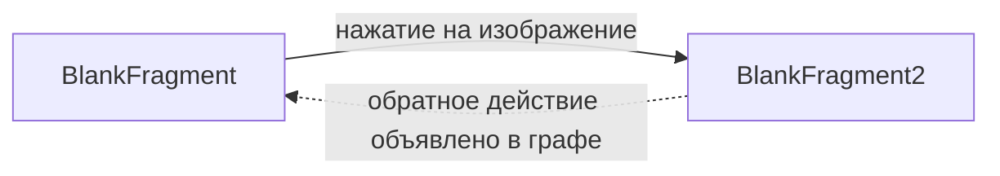

# Содержание

- [[#Что добавлено на занятии]]
- [[#Как устроена навигация]]
- [[#Подключение библиотек]]
- [[#NavHostFragment в разметке]]
- [[#Граф навигации]]
- [[#Переход по нажатию]]
- [[#Возврат и стек переходов]]
- [[#Аргументы фрагмента]]
- [[#Особенности учебного примера]]
- [[#Главное]]

## Что добавлено на занятии

**Тема: навигация между фрагментами с помощью Android Jetpack Navigation.** Конспект составлен по изменениям коммита [Lesson 10 `c0a69dc`](https://github.com/docfr10/LessonAndroidStart/commit/c0a69dc6322337c3387f7a7db84a2badb8793f84) от 10.11.2026 относительно Lesson 9. Это разбор исходного кода; сборка и запуск приложения не проверялись.

На предыдущем занятии вторая Activity содержала `BlankFragment` непосредственно в контейнере. Теперь контейнер в `MainActivity2` размещает `NavHostFragment`: он использует граф с двумя фрагментами. Нажатие на изображение в первом открывает второй внутри того же контейнера.

Путь пользователя в проекте: `MainActivity` → нажатие на `imageView` → `MainActivity2` → нажатие на изображение во фрагменте → `BlankFragment2`. Первый переход выполняется через `Intent` между Activity, второй — через Navigation внутри второй Activity.

## Как устроена навигация

| Элемент | Назначение в проекте |
|---|---|
| `NavHostFragment` | область, в которой показываются фрагменты графа |
| `navgraph.xml` | описание доступных пунктов назначения и действий между ними |
| `destination` | пункт назначения, здесь — один из двух фрагментов |
| `action` | именованный переход из одного пункта графа в другой |
| `NavController` | управляет переходами и стеком пунктов назначения |

Фрагмент — часть интерфейса, размещаемая внутри Activity. Переход между фрагментами в данном примере не создаёт новую Activity: меняется содержимое контейнера второй Activity. [Обзор Navigation](https://developer.android.com/guide/navigation).

## Подключение библиотек

В [`app/build.gradle.kts`](https://github.com/docfr10/LessonAndroidStart/blob/c0a69dc6322337c3387f7a7db84a2badb8793f84/app/build.gradle.kts) добавлены зависимости:

```kotlin
implementation("androidx.navigation:navigation-fragment-ktx:2.10.2")
implementation("androidx.navigation:navigation-ui-ktx:2.10.2")
```

Первая подключает поддержку Navigation для фрагментов и Kotlin-расширения, включая `findNavController()`. Вторая предназначена для связи навигации с компонентами интерфейса, например панелью приложения; в показанном коде такой связи нет. Номера версий приведены как значения учебного проекта, а не как рекомендация для нового приложения. После изменения зависимостей проект нужно синхронизировать с Gradle.

## NavHostFragment в разметке

В [`activity_main2.xml`](https://github.com/docfr10/LessonAndroidStart/blob/c0a69dc6322337c3387f7a7db84a2badb8793f84/app/src/main/res/layout/activity_main2.xml) контейнер объявлен следующим образом (ограничения расположения опущены):

```xml
<androidx.fragment.app.FragmentContainerView
    android:id="@+id/fragmentContainerView"
    android:name="androidx.navigation.fragment.NavHostFragment"
    android:layout_width="294dp"
    android:layout_height="238dp"
    app:defaultNavHost="true"
    app:navGraph="@navigation/navgraph" />
```

`android:name` создаёт именно хост навигации вместо непосредственного размещения `BlankFragment`. `app:navGraph` назначает ему граф. `app:defaultNavHost="true"` позволяет хосту участвовать в обработке системного возврата. Начальное содержимое определяется графом, а не именем конкретного фрагмента в контейнере. [Создание NavHost](https://developer.android.com/guide/navigation/use-graph/programmatic).

## Граф навигации

Файл [`res/navigation/navgraph.xml`](https://github.com/docfr10/LessonAndroidStart/blob/c0a69dc6322337c3387f7a7db84a2badb8793f84/app/src/main/res/navigation/navgraph.xml) содержит два пункта и по одному действию в каждом:

```xml
<navigation
    android:id="@+id/navgraph"
    app:startDestination="@id/blankFragment">
    <fragment
        android:id="@+id/blankFragment"
        android:name="com.example.lessonandroidstart.BlankFragment">
        <action
            android:id="@+id/action_blankFragment_to_blankFragment2"
            app:destination="@id/blankFragment2" />
    </fragment>
    <fragment
        android:id="@+id/blankFragment2"
        android:name="com.example.lessonandroidstart.BlankFragment2">
        <action
            android:id="@+id/action_blankFragment2_to_blankFragment"
            app:destination="@id/blankFragment" />
    </fragment>
</navigation>
```

Здесь опущены объявления пространств имён, подписи и `tools:layout`. `startDestination` выбирает первый фрагмент при первоначальном запуске графа; `android:name` связывает запись с Kotlin-классом; `app:destination` указывает цель действия. `tools:layout` в исходном XML помогает предварительному просмотру в редакторе и не заменяет создание представления в коде.



Обратная стрелка есть в графе, но в Kotlin-коде второго фрагмента вызова этого действия нет. Одно только объявление действия не создаёт кнопку и не выполняет переход.

## Переход по нажатию

В [`BlankFragment.kt`](https://github.com/docfr10/LessonAndroidStart/blob/c0a69dc6322337c3387f7a7db84a2badb8793f84/app/src/main/java/com/example/lessonandroidstart/BlankFragment.kt) разметка создаётся в `onCreateView`, а обработчик подключается в `onViewCreated`:

```kotlin
override fun onViewCreated(view: View, savedInstanceState: Bundle?) {
    super.onViewCreated(view, savedInstanceState)
    val imageView = view.findViewById<ImageView>(R.id.imageView2)
    imageView.setOnClickListener {
        findNavController().navigate(R.id.action_blankFragment_to_blankFragment2)
    }
}
```

Параметр `view` — уже созданный корневой элемент разметки фрагмента. Поиск через него ограничен деревом этого фрагмента. `setOnClickListener` регистрирует обработчик; код в фигурных скобках выполняется только при нажатии. `findNavController()` находит контроллер связанного хоста, а `navigate(...)` выполняет действие графа по его ID.

Первый фрагмент создаёт `fragment_blank.xml` вызовом `inflater.inflate(..., container, false)`. Значение `false` означает, что `inflate` сам не присоединяет разметку к контейнеру: это делает инфраструктура фрагментов. Второй фрагмент аналогично возвращает `fragment_blank2.xml`, где находится `TextView` с ресурсной строкой.

## Возврат и стек переходов

При обычном переходе к `BlankFragment2` контроллер добавляет пункт назначения в свой стек. Системная кнопка «Назад» обычно удаляет верхний пункт и показывает предыдущий. Когда для текущего хоста больше нечего снимать со стека, дальнейшее поведение возврата определяется Activity и системой. [Стек Navigation](https://developer.android.com/guide/navigation/backstack).

Обратное действие `action_blankFragment2_to_blankFragment` и возврат по системной кнопке — разные операции. Если вызвать обычное `navigate` по обратному действию без специальных настроек, может добавиться ещё один экземпляр пункта назначения; для возврата к предыдущему состоянию используют `popBackStack()` или системный Back. В учебном коде второй обработчик и `popBackStack()` не реализованы.

## Аргументы фрагмента

В [`BlankFragment2.kt`](https://github.com/docfr10/LessonAndroidStart/blob/c0a69dc6322337c3387f7a7db84a2badb8793f84/app/src/main/java/com/example/lessonandroidstart/BlankFragment2.kt) остался шаблон Android Studio: `newInstance(param1, param2)` кладёт строки в `Bundle`, а `onCreate` читает их через `arguments?.let { ... }`. Ключи — `"param1"` и `"param2"`.

При показанном переходе вызывается `navigate` только с ID действия: значения не передаются, `newInstance` не вызывается, а прочитанные поля далее не используются. Передача строки из `MainActivity` в `MainActivity2` через `Intent` с ключом `"value"` — отдельный механизм; эта строка автоматически не становится аргументом второго фрагмента. Для передачи аргументов через Navigation их нужно отдельно определить и передать; пример этого в коммите отсутствует. [Передача данных между пунктами назначения](https://developer.android.com/guide/navigation/use-graph/pass-data).

## Особенности учебного примера

- `findNavController` импортирован в `MainActivity2`, но там не используется; переход вызывается из первого фрагмента.
- У изображения первого фрагмента указан размер `262 × 314 dp`, тогда как контейнер — `294 × 238 dp`: содержимое может не помещаться по высоте. Размеры и адаптацию стоит проверить на устройстве.
- Изображение используется как кнопка. Для доступности интерактивному элементу нужна понятная текстовая подпись и подходящая семантика; внешний вид и доступность стоит проверить отдельно.
- Версии библиотек в файле — часть исходного снимка. Совместимость зависимостей и работоспособность проекта сборкой здесь не проверены.

## Главное

- Граф описывает пункты назначения и допустимые именованные переходы; хост отображает текущий пункт.
- `startDestination` задаёт начальный фрагмент графа, а `navigate` запускает переход при событии.
- Размещение фрагмента внутри Activity и запуск новой Activity через `Intent` — разные уровни навигации.
- Действие в графе само по себе не выполняется; для него нужен вызов.
- Системный возврат снимает пункт со стека; переход в обратную сторону через `navigate` может добавить новый пункт.
- Шаблон `newInstance` не передаёт данные автоматически при переходе через Navigation.
