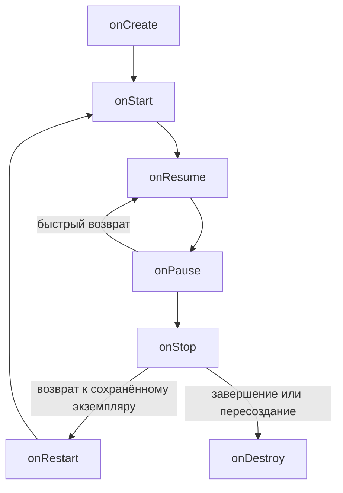

# Содержание

- [Что изучается в проекте](#что-изучается-в-проекте)
- [Структура Android-проекта](#структура-android-проекта)
- [Gradle и настройки приложения](#gradle-и-настройки-приложения)
- [Манифест и запуск приложения](#манифест-и-запуск-приложения)
- [Activity и создание экрана](#activity-и-создание-экрана)
- [XML-разметка и ConstraintLayout](#xml-разметка-и-constraintlayout)
- [Ресурсы и локализация](#ресурсы-и-локализация)
- [Обращение к элементам интерфейса](#обращение-к-элементам-интерфейса)
- [TextView и Button](#textview-и-button)
- [Switch и CheckBox](#switch-и-checkbox)
- [ImageView и ImageButton](#imageview-и-imagebutton)
- [EditText и TextWatcher](#edittext-и-textwatcher)
- [WebView](#webview)
- [Края экрана и системные отступы](#края-экрана-и-системные-отступы)
- [Жизненный цикл Activity](#жизненный-цикл-activity)
- [Поворот экрана и сохранение состояния](#поворот-экрана-и-сохранение-состояния)
- [Logcat и тесты](#logcat-и-тесты)
- [Что важно уточнить в учебном коде](#что-важно-уточнить-в-учебном-коде)
- [Главное](#главное)

## Что изучается в проекте

**Тема: начало разработки Android-приложений на Kotlin, занятия 7–8.** Репозиторий показывает создание экрана через XML, работу с элементами интерфейса, обработку событий и жизненный цикл `Activity`.

Конспект подготовлен по ветке `master`, коммиту [`7083137` — Lesson 7-8 v.2](https://github.com/docfr10/LessonAndroidStart/commit/7083137695b19f4400aec77a896fde88cdd5e671) от **27.10.2026**. Это разбор исходного кода; сборка и запуск приложения не проверялись. Примеры с пометкой «учебный вариант» поясняют тему и могут отличаться от репозитория.

Основная логика находится в одной `MainActivity`. При создании экрана программа задаёт надписи, подключает обработчики кнопок и поля ввода, затем вызывает загрузку страницы в `WebView`. Поле ввода демонстрирует отслеживание текста, а обычная кнопка — изменение свойств элементов.

## Структура Android-проекта

| Файл или каталог | Назначение в этом проекте |
|---|---|
| `settings.gradle.kts` | имя проекта, подключение модуля `app`, репозитории зависимостей |
| `build.gradle.kts` в корне | объявление общего плагина Android |
| `gradle/libs.versions.toml` | версии библиотек и их короткие имена |
| `app/build.gradle.kts` | настройки сборки приложения и включение View Binding |
| `app/src/main/AndroidManifest.xml` | сведения о приложении и объявление стартовой Activity |
| `app/src/main/java/com/example/lessonandroidstart/MainActivity.kt` | Kotlin-код экрана |
| `app/src/main/res/layout/activity_main.xml` | основной вариант разметки |
| `app/src/main/res/layout-land/activity_main.xml` | вариант разметки для горизонтального экрана |
| `app/src/main/res/values/` | строки, цвета и тема по умолчанию |
| `app/src/main/res/values-ru/` | русские строки |
| `app/src/main/res/values-night/` | вариант темы для тёмного режима |
| `app/src/main/res/drawable/` | изображения и XML-описания графики |
| `app/src/main/res/mipmap-.../` | ресурсы значка приложения |
| `app/src/test/` | локальный пример теста |
| `app/src/androidTest/` | пример теста на Android-устройстве или эмуляторе |

**Разделение обязанностей:** XML описывает состав и расположение элементов, Kotlin задаёт их поведение, ресурсы хранят общие значения, Gradle управляет сборкой.

Исходники: [дерево проекта на выбранном коммите](https://github.com/docfr10/LessonAndroidStart/tree/7083137695b19f4400aec77a896fde88cdd5e671).

## Gradle и настройки приложения

В [настройках модуля `app`](https://github.com/docfr10/LessonAndroidStart/blob/7083137695b19f4400aec77a896fde88cdd5e671/app/build.gradle.kts) указаны:

| Настройка | Значение | Смысл |
|---|---|---|
| `namespace` | `com.example.lessonandroidstart` | пространство имён генерируемых классов, включая `R` |
| `applicationId` | `com.example.lessonandroidstart` | идентификатор установленного приложения |
| `compileSdk` | `37` | версия Android API, используемая при компиляции |
| `minSdk` | `24` | минимальный поддерживаемый уровень Android API |
| `targetSdk` | `37` | уровень API, на поведение которого ориентируется приложение |
| `versionCode` | `1` | внутренний номер версии |
| `versionName` | `1.0` | отображаемое обозначение версии |
| `viewBinding` | `true` | генерация классов для доступа к XML-элементам |

`namespace` и `applicationId` в примере совпадают, но отвечают за разные вещи. `targetSdk` не задаёт минимальную версию устройства: за неё отвечает `minSdk`.

Файлы `.gradle.kts` используют **Kotlin DSL** — способ описать настройки Gradle на Kotlin. Это конфигурация сборки, а не код обработки нажатий.

В [каталоге версий](https://github.com/docfr10/LessonAndroidStart/blob/7083137695b19f4400aec77a896fde88cdd5e671/gradle/libs.versions.toml) зафиксированы Android Gradle Plugin `9.4.1`, AppCompat `1.8.0`, Material `1.14.0`, ConstraintLayout `2.2.2` и другие зависимости. Вызов `implementation(libs.androidx.appcompat)` использует короткое имя из этого каталога. Это значения данного снимка проекта, а не требование ставить их в любой новый проект.

Gradle Wrapper указывает Gradle `9.6.0`. Файл настройки JVM для Gradle задаёт JDK `25`, а `compileOptions` — совместимость Java-кода с Java `11`. **Среда запуска сборщика и уровень совместимости компилируемого Java-кода — разные настройки.**

## Манифест и запуск приложения

[`AndroidManifest.xml`](https://github.com/docfr10/LessonAndroidStart/blob/7083137695b19f4400aec77a896fde88cdd5e671/app/src/main/AndroidManifest.xml) описывает приложение для Android.

В теге `<application>` находятся название через `@string/app_name`, значки, тема `Theme.LessonAndroidStart`, настройки резервного копирования и поддержка направления текста справа налево.

Для `MainActivity` задан фильтр:

```xml
<intent-filter>
    <action android:name="android.intent.action.MAIN" />
    <category android:name="android.intent.category.LAUNCHER" />
</intent-filter>
```

Сочетание `MAIN` и `LAUNCHER` объявляет Activity входом при запуске через значок приложения. `android:name=".MainActivity"` указывает класс. `android:exported="true"` разрешает запуск Activity извне приложения, в том числе системным лаунчером.

`android:windowSoftInputMode="adjustResize"` задаёт режим изменения доступной области окна при появлении клавиатуры; фактическое размещение содержимого также зависит от обработки системных отступов.

В Kotlin-файле есть `SecondActivity`, но в манифесте она не объявлена и переход к ней не реализован. Само объявление класса не создаёт второй работающий экран. Более того, в ней переопределён специальный двухпараметрический `onCreate(Bundle?, PersistableBundle?)`, связанный с режимом `persistAcrossReboots`. Для обычного экрана используют `onCreate(Bundle?)`. См. [справочник Activity](https://developer.android.com/reference/android/app/Activity#onCreate(android.os.Bundle,%20android.os.PersistableBundle)).

## Activity и создание экрана

**Activity** — компонент Android, который управляет окном интерфейса и получает события жизненного цикла. В примере `MainActivity` наследуется от `AppCompatActivity`.

Сокращённый учебный вариант инициализации:

```kotlin
class MainActivity : AppCompatActivity() {
    private lateinit var binding: ActivityMainBinding

    override fun onCreate(savedInstanceState: Bundle?) {
        super.onCreate(savedInstanceState)
        binding = ActivityMainBinding.inflate(layoutInflater)
        setContentView(binding.root)
        // Здесь можно обращаться к элементам через binding.
    }
}
```

`override` переопределяет метод базового класса, а `super.onCreate(...)` вызывает его реализацию. `savedInstanceState` может содержать ранее сохранённое состояние; при первом создании обычно равен `null`.

`inflate(layoutInflater)` создаёт дерево объектов интерфейса из XML. `setContentView(...)` устанавливает его как содержимое Activity. В репозитории передаётся `binding.main`: в данном макете это корневой `ConstraintLayout` с ID `main`. Запись `binding.root` выражает то же назначение без привязки к имени ID.

`lateinit` позволяет присвоить `binding` позже, в `onCreate`. Доступ до присваивания вызовет `UninitializedPropertyAccessException`. [Создание экрана через View Binding](https://developer.android.com/topic/libraries/view-binding).

## XML-разметка и ConstraintLayout

Оба варианта [`activity_main.xml`](https://github.com/docfr10/LessonAndroidStart/blob/7083137695b19f4400aec77a896fde88cdd5e671/app/src/main/res/layout/activity_main.xml) используют **ConstraintLayout** — контейнер, размещающий элементы по связям с другими элементами и границами родителя.

Основные атрибуты:

| Атрибут | Что задаёт |
|---|---|
| `android:id="@+id/button"` | объявляет ID элемента |
| `android:layout_width`, `android:layout_height` | ширину и высоту |
| `wrap_content` | размер по содержимому |
| `match_parent` | размер по доступной области родителя; в проекте так задан корневой контейнер |
| `android:layout_margin...` | внешний отступ |
| `android:text` | текст элемента |
| `app:layout_constraintTop_toBottomOf` | связывает верх элемента с низом другого |
| `app:layout_constraintStart_toStartOf` | связывает начальные края |
| `tools:context` | подсказку редактору разметки, а не регистрацию Activity |

`@+id/name` объявляет ID, `@id/name` ссылается на существующий. В Kotlin к ID обращаются через `R.id.name`.

Если элемент фиксированной ширины или `wrap_content` связан с двух сторон, **bias** смещает его между ограничениями: `0.5` — середина, значения ближе к `0` — к началу, ближе к `1` — к концу. `0dp` в соответствующем измерении ConstraintLayout означает размер по ограничениям — **match constraints**. Размеры и отступы задают в `dp`, размер текста — обычно в `sp`. [Правила ConstraintLayout](https://developer.android.com/develop/ui/views/layout/constraint-layout).

В проекте встречаются крупный отступ `456dp` и фиксированные размеры картинок. По коду это учебная компоновка: её удобство на разных размерах экрана нужно проверять отдельно.

## Ресурсы и локализация

**Ресурс** — именованное значение, к которому можно обращаться из XML и Kotlin.

| Обращение | Что обозначает |
|---|---|
| `R.layout.activity_main` | разметку |
| `R.id.button` | ID элемента |
| `R.string.app_name` | строку |
| `R.drawable.images` | картинку `images.jpeg` |
| `@string/button_text` | строковый ресурс внутри XML |
| `@android:drawable/ic_menu_myplaces` | встроенный ресурс Android |

В проекте [строки по умолчанию](https://github.com/docfr10/LessonAndroidStart/blob/7083137695b19f4400aec77a896fde88cdd5e671/app/src/main/res/values/strings.xml) содержат название `LessonAndroidStart` и `Button`, а [русский вариант](https://github.com/docfr10/LessonAndroidStart/blob/7083137695b19f4400aec77a896fde88cdd5e671/app/src/main/res/values-ru/strings.xml) — русские значения с теми же ключами.

Android выбирает подходящие ресурсы по конфигурации. `values/` — набор по умолчанию, `values-ru/` — для русского языка. Пользовательские надписи удобно хранить в строковых ресурсах, чтобы переводить их без изменения логики. [Локализация Android-приложения](https://developer.android.com/guide/topics/resources/localization).

В примере есть две особенности:

- У `button_text` в основном файле стоит `translatable="false"`, хотя русский перевод этого ключа присутствует. Для переводимой строки этот флаг следует убрать.
- Kotlin присваивает кнопке строку `"Я кнопка"`, поэтому начальная надпись из XML заменяется. Строки, записанные прямо в Kotlin, автоматически переводиться не будут.

Тема наследуется от `Theme.Material3.DayNight.NoActionBar`. Есть отдельный файл в `values-night`, но собственные цвета светлого и тёмного режимов в нём не настроены.

## Обращение к элементам интерфейса

В [`MainActivity.kt`](https://github.com/docfr10/LessonAndroidStart/blob/7083137695b19f4400aec77a896fde88cdd5e671/app/src/main/java/com/example/lessonandroidstart/MainActivity.kt) показаны два способа.

**Поиск по ID:**

```kotlin
val label = findViewById<TextView>(R.id.textView)
label.text = "Новая надпись"
```

**View Binding:**

```kotlin
binding.textView.text = "Новая надпись"
```

View Binding включается в `buildFeatures` настройкой `viewBinding = true`. Из имени `activity_main.xml` получается класс `ActivityMainBinding`, в котором есть ссылки на элементы с ID. Это сокращает ручной поиск и даёт типизированный доступ. `findViewById` остаётся действующим API: комментарий «устаревший способ» в учебном коде не означает, что метод официально запрещён или удалён. [Сравнение способов](https://developer.android.com/topic/libraries/view-binding#differences-from-findviewbyid).

**Почему `binding.imageButton` допускает `null`:** картинка-кнопка есть в основном макете, но отсутствует в `layout-land`. Для элемента, существующего только в части вариантов разметки, Binding создаёт nullable-ссылку. Поэтому код использует безопасный вызов `?.`: в горизонтальной ориентации обработчик для отсутствующей кнопки просто не устанавливается.

## TextView и Button

**TextView** отображает текст. При создании экрана код заменяет XML-надпись на `"Привет, я TextView"` и задаёт зелёный цвет через `setTextColor(Color.GREEN)`.

**Button** запускает действие по нажатию. `setOnClickListener { ... }` регистрирует лямбду: её тело выполнится при событии, а не в момент регистрации.

Точное поведение обычной кнопки в репозитории:

| Момент | Текст кнопки | Текст TextView | Состояние кнопки |
|---|---|---|---|
| После начальной настройки в `onCreate` | `Я кнопка` | `Привет, я TextView` | доступна |
| После нажатия | `Я нажата` | `На меня нажали` | `isClickable = false`, `isEnabled = false` |

`isClickable` управляет обработкой клика. `isEnabled` задаёт доступность элемента и обычно влияет на его оформление через тему. Цвет отключённой кнопки зависит от стиля. Если требуется отключить кнопку с обычной визуальной обратной связью, как правило, достаточно `isEnabled = false`.

## Switch и CheckBox

**Switch** — переключатель с двумя состояниями. Его текущее состояние читают через `isChecked`.

В XML `switch1` изначально включён: `android:checked="true"`. Обработчик клика задаёт текст `"Кнопка нажата"` при включённом состоянии и `"Кнопка не нажата"` при выключенном. До первого клика остаётся XML-надпись `Switch`, поскольку обработчик ещё не выполнялся.

Учебный вариант реакции именно на изменение состояния:

```kotlin
binding.switch1.setOnCheckedChangeListener { view, checked ->
    view.text = if (checked) "Включено" else "Выключено"
}
```

Обработчик клика сообщает о нажатии, а `setOnCheckedChangeListener` — об изменении отметки, в том числе программном.

**CheckBox** — флажок, состояние которого также доступно через `isChecked`. В репозитории он только размещён в XML: прикладная реакция на его переключение не написана.

**Spinner** — выпадающий список. Элемент `spinner2` присутствует в обоих макетах, но набор вариантов и адаптер в коде не заданы; полноценный выбор из списка здесь не реализован.

## ImageView и ImageButton

**ImageView** показывает изображение. В макете он использует `@drawable/images`, соответствующий файлу `images.jpeg`.

**ImageButton** — кнопка с изображением. Изначально она показывает встроенный значок `@android:drawable/ic_menu_myplaces`. По нажатию код меняет его на `R.drawable.ic_launcher_foreground`.

Безопасный учебный вариант обработчика:

```kotlin
binding.imageButton?.let { imageButton ->
    imageButton.setOnClickListener {
        imageButton.setImageResource(R.drawable.ic_launcher_foreground)
    }
}
```

В исходнике после смены изображения есть выражение `binding.imageButton?.minimumWidth`. Оно только читает свойство, а результат нигде не используется. **Чтение свойства не меняет ширину.**

## EditText и TextWatcher

**EditText** позволяет редактировать текст. В проекте элемент называется `editTextTextEmailAddress` и имеет `inputType="textEmailAddress"`: это настройка типа ввода и подходящей клавиатуры, а не проверка корректности e-mail.

Начальное значение поля задано через `android:text`. Для подсказки вместо заранее введённого текста используют `android:hint`.

Получить строку можно так:

```kotlin
val enteredText = binding.editTextTextEmailAddress.text.toString()
```

Отдельное выражение `binding.editTextTextEmailAddress.text` в исходнике лишь получает текущее содержимое. Изменения отслеживает подключённый далее **TextWatcher**.

Последовательность вызовов при изменении текста:

1. `beforeTextChanged(s, start, count, after)` — до замены фрагмента.
2. `onTextChanged(s, start, before, count)` — после замены, с информацией о ней.
3. `afterTextChanged(s)` — после изменения, с доступом к `Editable`.

В исходнике параметры названы `p0`, `p1`, `p2`, `p3`. Для `onTextChanged` их смысл такой:

| Имя в репозитории | Смысл |
|---|---|
| `p0` | текст после изменения |
| `p1` | индекс начала изменённого фрагмента |
| `p2` | сколько прежних символов заменено |
| `p3` | сколько новых символов вставлено |

Если заменить `б` на `XY` в строке `абв`, получится `аXYв`: `start = 1`, `before = 1`, `count = 2`. Это длины изменяемого фрагмента, а не обязательно всей строки.

Конструкция `object : TextWatcher { ... }` создаёт анонимный объект, реализующий интерфейс. Менять наблюдаемый текст внутри `beforeTextChanged` и `onTextChanged` нельзя. В `afterTextChanged` это допустимо, но может повторно вызвать наблюдатель и привести к рекурсии. [Контракт TextWatcher](https://developer.android.com/reference/android/text/TextWatcher).

В этом проекте наблюдатель только выводит текст и параметры изменений в журнал.

## WebView

**WebView** отображает веб-содержимое внутри экрана. В конце `onCreate` вызывается `binding.webView.loadUrl("https://google.com")`.

Для сетевой загрузки необходимо разрешение в манифесте, непосредственно внутри `<manifest>`:

```xml
<uses-permission android:name="android.permission.INTERNET" />
```

В манифесте репозитория эта строка отсутствует. Вызов `loadUrl` показывает намерение загрузить сайт, но сам по себе не обеспечивает доступ к сети. [Требование разрешения для WebView](https://developer.android.com/develop/ui/views/layout/webapps/webview#add_a_webview_to_your_app).

Настройка `WebViewClient` и включение JavaScript в примере также не показаны. `WebViewClient` используют для управления переходами и событиями загрузки. JavaScript по умолчанию выключен; его включают, если этого требует отображаемая страница. Отдельных кнопок навигации и адресной строки `WebView` автоматически не создаёт.

## Края экрана и системные отступы

В `onCreate` вызывается `enableEdgeToEdge()`: содержимое окна может размещаться под системными панелями.

Затем обработчик `ViewCompat.setOnApplyWindowInsetsListener(...)` получает размеры областей `WindowInsetsCompat.Type.systemBars()` и передаёт их в `setPadding(left, top, right, bottom)` корневого контейнера.

**Смысл:** внутренние отступы помогают содержимому не перекрываться строкой состояния и системной навигацией. Это не специальное увеличение области нажатия кнопок, как можно понять из комментария в исходнике. Обработчик также не учитывает явно отступы экранной клавиатуры типа `ime()`. [Edge-to-edge и системные отступы](https://developer.android.com/develop/ui/views/layout/edge-to-edge).

## Жизненный цикл Activity

Android вызывает методы жизненного цикла при изменениях состояния экрана:

| Метод | Основное назначение |
|---|---|
| `onCreate` | первоначальная настройка нового экземпляра Activity |
| `onStart` | Activity становится видимой |
| `onResume` | Activity переходит в активное состояние |
| `onPause` | Activity теряет активное состояние; ещё может быть видимой |
| `onStop` | Activity больше не видна |
| `onRestart` | подготовка к повторному запуску остановленного экземпляра |
| `onDestroy` | уничтожение экземпляра Activity |

Типичные переходы:



Методы сообщают о переходах; `onPause` не является командой «разрешить выход», а `onRestart` не вызывается после каждого `onStop` безусловно. `onDestroy` возможен при повороте экрана и не гарантирован при завершении процесса системой. Поэтому важные данные нельзя сохранять исключительно в нём. [Жизненный цикл Activity](https://developer.android.com/guide/components/activities/activity-lifecycle).

В репозитории переопределены все перечисленные методы. После вызова `super` в методах от `onStart` до `onDestroy` записывается сообщение в журнал, что позволяет наблюдать переходы.

## Поворот экрана и сохранение состояния

По умолчанию изменение ориентации приводит к пересозданию Activity. Новый экземпляр заново выполняет `onCreate` и получает подходящие ресурсы. В проекте нет настройки, отменяющей это поведение. [Изменения конфигурации](https://developer.android.com/guide/topics/resources/runtime-changes).

Два файла с одинаковым именем решают задачу выбора разметки:

| Условия | Используемый вариант |
|---|---|
| Нет более подходящего варианта | `res/layout/activity_main.xml` |
| Горизонтальная ориентация | `res/layout-land/activity_main.xml` |

Отдельный экран для этого не создаётся. В коде остаётся тот же `ActivityMainBinding`, но фактическое дерево элементов зависит от выбранного XML. В горизонтальном варианте отсутствует `ImageButton`, а расположение и размеры ряда других элементов отличаются.

**Состояние нужно продумывать отдельно от разметки.** При новом `onCreate` снова выполняются начальные присваивания надписей и вызов загрузки сайта. Собственное состояние «кнопка уже нажата» явно не сохраняется. Стандартные Views с ID могут автоматически восстанавливать часть своего состояния, например введённый текст, но это не заменяет хранение состояния экрана.

Для развития примера можно хранить состояние в `ViewModel`, а небольшие значения, необходимые после пересоздания процесса, — через `savedInstanceState` или `SavedStateHandle`. Эти механизмы в данном репозитории не реализованы.

## Logcat и тесты

**Logcat** — журнал Android, который помогает отслеживать выполнение программы. В примере используются:

- `println(...)` — простой вывод значений;
- `Log.d(tag, message)` — отладочные сообщения о вводимом тексте;
- `Log.e(tag, message)` — сообщения о переходах жизненного цикла.

Первый аргумент `Log` — метка для поиска и фильтрации, второй — текст сообщения. Сам вызов `Log.e` не означает, что приложение упало: в этом проекте автор использует уровень ошибок для обычных событий. Для таких наблюдений можно выбрать `Log.d`.

В репозитории находятся два шаблонных теста: [локальный](https://github.com/docfr10/LessonAndroidStart/blob/7083137695b19f4400aec77a896fde88cdd5e671/app/src/test/java/com/example/lessonandroidstart/ExampleUnitTest.kt) проверяет `2 + 2 == 4`, а [инструментальный](https://github.com/docfr10/LessonAndroidStart/blob/7083137695b19f4400aec77a896fde88cdd5e671/app/src/androidTest/java/com/example/lessonandroidstart/ExampleInstrumentedTest.kt) — имя пакета приложения. Они не проверяют нажатия, поворот экрана или загрузку сайта.

## Что важно уточнить в учебном коде

| Фрагмент или комментарий | Правильное понимание |
|---|---|
| `findViewById` назван устаревшим | Это поддерживаемый способ; View Binding удобнее для показанного экрана |
| Обработка insets названа увеличением пространства для кликов | Код задаёт padding с учётом системных панелей |
| `onPause` описан как возможность выйти из приложения | Это уведомление об изменении состояния Activity |
| `binding.imageButton?.minimumWidth` | Значение прочитано, но ширина не изменяется |
| `binding.editTextTextEmailAddress.text` отдельной строкой | Содержимое получено, но не сохранено и не использовано |
| `inputType="textEmailAddress"` | Подходящий режим ввода; проверки e-mail здесь нет |
| `translatable="false"` вместе с русским переводом | Настройку переводимости нужно согласовать с наличием перевода |
| Загрузка сайта в WebView | В исходном манифесте не объявлено разрешение `INTERNET` |
| Есть `SecondActivity`, `CheckBox` и `Spinner` | Переход ко второму экрану и прикладная логика этих элементов не реализованы |

## Главное

- Android запускает объявленную в манифесте Activity; её `onCreate` создаёт и настраивает экран.
- XML задаёт структуру и размещение элементов, Kotlin — их поведение.
- View Binding связывает XML с кодом; отсутствие элемента в одном варианте макета объясняет nullable-ссылку.
- Обработчик события регистрируют заранее, а выполняется он при соответствующем действии.
- `TextWatcher` сообщает, какой фрагмент текста изменился; тип клавиатуры не заменяет проверку ввода.
- Ресурсы позволяют выбирать строки, темы и разметку по конфигурации устройства.
- Жизненный цикл — система переходов, а поворот экрана обычно создаёт новый экземпляр Activity.
- Учебный код демонстрирует API, но содержит незавершённые настройки и неточные комментарии, разобранные выше.
